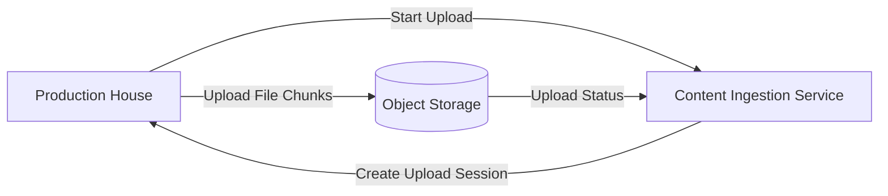
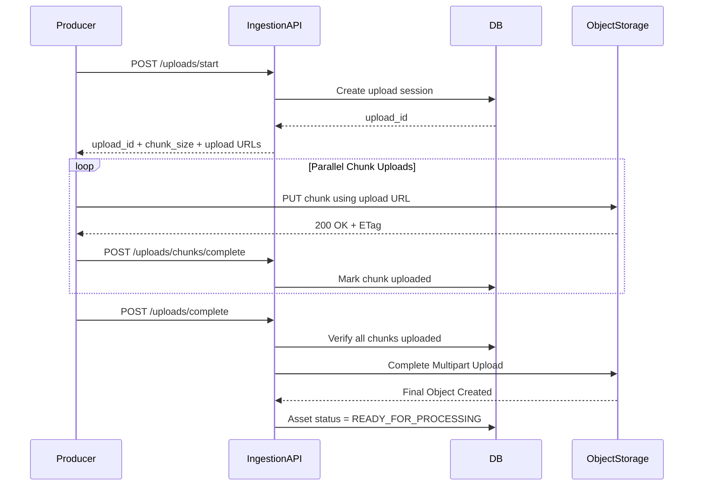
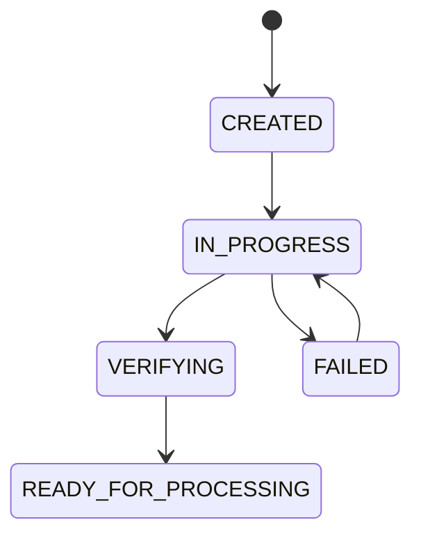
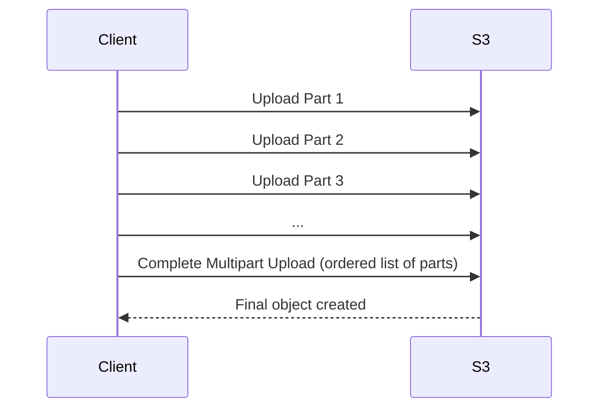
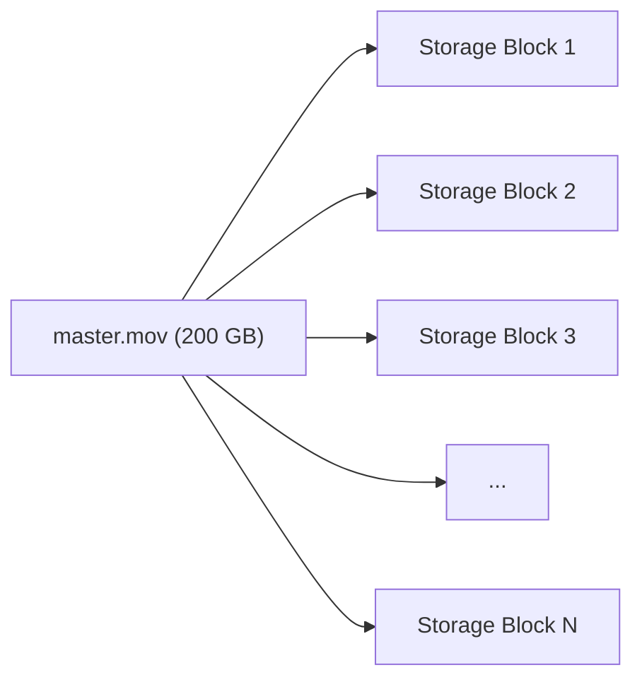
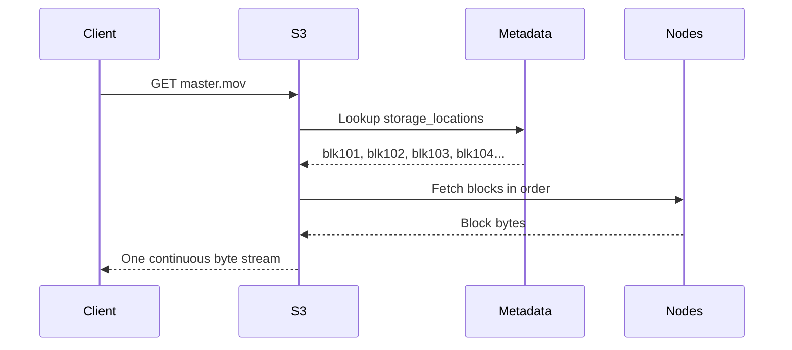
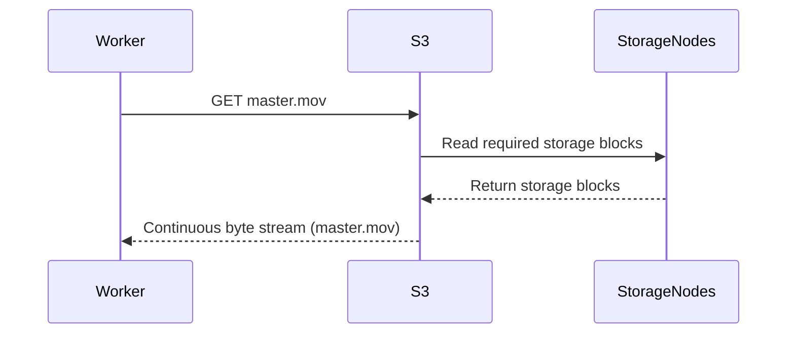
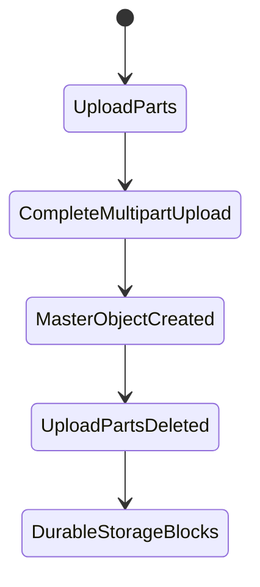

# Netflix System Design — Part 1: Content Upload (Production House → Netflix)

## Goal

Understand how a production house uploads a movie to Netflix before any transcoding or streaming happens.

---

## Step 1 — What does the production house upload?

A production house uploads a **master video asset**, not a consumer MP4.

### Typical Master Video

| Property | Example |
|----------|---------|
| Resolution | 3840×2160 (4K UHD) or 4096×2160 (DCI 4K) |
| Frame Rate | 24 / 30 / 60 FPS |
| Codec | Apple ProRes, DNxHR, RAW |
| Bit Depth | 10-bit / 12-bit |
| File Size | 100–500 GB |

### Resolution vs Quality

| Resolution | Quality (Bitrate) |
|------------|-------------------|
| Number of pixels (720p, 1080p, 4K). | Amount of data stored/transmitted per second of video. |

**Example**

- 4K @ **40 Mbps** → High visual quality.
- 4K @ **8 Mbps** → Same resolution, but more compression.

> Netflix never creates a true resolution higher than the source video. If the source is 1080p, Netflix generates renditions only up to 1080p.

---

## Step 2 — Upload Starts

The production house uploads the master asset using Netflix's **Content Ingestion Service**.

### High-Level Flow



---

## Why Multipart Upload?

A 200 GB file is **not uploaded as one request**.

Instead, it is divided into multiple chunks.

### Benefits

- Retry only failed chunks.
- Upload chunks in parallel.
- Resume upload after network interruption.
- Better throughput over long-distance networks.

---

## What happens at this stage?

1. Producer requests a new upload session.
2. Netflix creates an upload session and returns an `upload_id`.
3. The producer starts uploading chunks associated with that upload session.
4. Netflix tracks which chunks have arrived.
5. After every chunk is uploaded, the file is marked **Ready for Processing**.

---

## We are intentionally skipping these details for now

These deserve their own chapter:

- How chunking actually happens in memory.
- Upload session database schema.
- Checksums and integrity verification.
- Parallel uploads and retries.
- Object storage assembly.
- Resume after interruption.

---


# Netflix System Design — Part 2: Multipart Upload Internals (200 GB Movie Upload)

## Goal

Understand **exactly** how Netflix uploads a 200 GB master video from a production house into its storage system.

This chapter covers only the upload pipeline — from creating an upload session until the final master video is stored in Object Storage.

---

# Functional Requirement

> A production house wants to upload a 200 GB movie to Netflix reliably, even if the network fails midway.

## Non-Functional Requirements

- Upload files of hundreds of GBs or TBs.
- Resume uploads after failures.
- Upload multiple chunks in parallel.
- Verify integrity of every chunk.
- Prevent duplicate uploads during retries.
- Keep application servers free from handling 200 GB of traffic.

---

# High-Level Upload Architecture



---

# Step 1 — Create Upload Session

Before uploading any bytes, the producer creates an upload session.

## API

```http
POST /v1/uploads/start
```

## Request

```json
{
  "title": "Avengers Endgame",
  "file_name": "endgame_master.mov",
  "file_size": 214748364800,
  "content_type": "video/quicktime"
}
```

## Backend Work

The Ingestion Service:

1. Authenticates the production house.
2. Creates an upload session in the database.
3. Calculates chunk configuration.
4. Creates upload URLs for Object Storage.

## Response

```json
{
  "upload_id": "upl_9a81f3",
  "chunk_size": 67108864,
  "total_chunks": 3200,
  "expires_at": "2026-09-20T10:00:00Z",
  "upload_urls": [
    {
      "chunk_number": 1,
      "url": "https://storage.netflix.com/upload?...partNumber=1"
    },
    {
      "chunk_number": 2,
      "url": "https://storage.netflix.com/upload?...partNumber=2"
    }
  ]
}
```

## Why does the server return Upload URLs?

The client uploads **directly to Object Storage** instead of sending 200 GB through the Ingestion API.

**Benefit**

- API servers handle metadata only.
- Object Storage handles heavy network traffic.

---

# Step 2 — Client Splits the File into Chunks

The producer's upload client performs chunking locally.

## Example

```text
Movie Size  = 200 GB
Chunk Size  = 64 MB
Total Chunks = 3200
```

## Chunk Layout

| Chunk | Byte Range |
|-------|------------|
| 1 | 0 → 64 MB |
| 2 | 64 MB → 128 MB |
| 3 | 128 MB → 192 MB |
| ... | ... |
| 3200 | Remaining bytes |

## Important

The client reads **64 MB from disk at a time**.

It never loads the complete 200 GB file into memory.

---

# Step 3 — Parallel Chunk Upload

Instead of uploading sequentially, multiple workers upload chunks simultaneously.

```text
Worker 1 → Chunk 1
Worker 2 → Chunk 2
Worker 3 → Chunk 3
Worker 4 → Chunk 4
Worker 5 → Chunk 5
...
```

## Why parallel uploads?

- Better bandwidth utilization.
- Lower total upload time.
- Failed chunks don't block successful chunks.

Typical concurrency is **4–32 workers**, depending on available bandwidth.

---

# Step 4 — Upload a Chunk to Object Storage

The upload client uses the upload URL received earlier.

## Request

```http
PUT https://storage.netflix.com/upload?...partNumber=15

Body: <64 MB binary data>
```

## Headers

```http
Content-Length: 67108864
Checksum: sha256(...)
```

## Response from Object Storage

```http
HTTP/1.1 200 OK

ETag: "9f6203b8a1..."
```

## What is uploaded?

Only **raw bytes of Chunk 15**.

At this stage there is **no complete movie object**.

---

# Step 5 — Notify Netflix That Chunk Upload Succeeded

Uploading to Object Storage is **not enough**.

The client informs the Ingestion Service after receiving `200 OK`.

## API

```http
POST /v1/uploads/chunks/complete
```

## Request

```json
{
  "upload_id": "upl_9a81f3",
  "chunk_number": 15,
  "etag": "9f6203b8a1...",
  "checksum": "sha256(...)"
}
```

## Backend Work

The Ingestion Service:

- Verifies upload session.
- Stores chunk metadata.
- Marks chunk as uploaded.
- Updates upload progress.

This API is **idempotent**.

Calling it multiple times for the same chunk is safe.

---

# Step 6 — Where Are Chunks Stored?

During upload, chunks are temporary objects.

```text
uploads/
└── upl_9a81f3/
    ├── part-1
    ├── part-2
    ├── part-3
    ├── ...
    └── part-3200
```

The final movie **does not exist yet**.

Object Storage only stores temporary parts.

---

# Step 7 — Metadata Stored by Netflix

## upload_sessions Table

| Column | Purpose |
|--------|---------|
| upload_id | Upload session identifier |
| producer_id | Owner of upload |
| asset_id | Movie identifier |
| file_name | Original uploaded file |
| total_size | File size |
| chunk_size | Size of each chunk |
| total_chunks | Expected chunk count |
| uploaded_chunks | Progress counter |
| status | CREATED / IN_PROGRESS / COMPLETED / FAILED |

## upload_chunks Table

| Column | Purpose |
|--------|---------|
| upload_id | Session reference |
| chunk_number | Chunk index |
| etag | Object Storage ETag |
| checksum | Client checksum |
| size | Uploaded size |
| status | PENDING / UPLOADED |

## Why two tables?

- `upload_sessions` stores overall upload state.
- `upload_chunks` tracks every individual chunk.

---

# Step 8 — Upload Progress

Whenever `/uploads/chunks/complete` succeeds:

```text
uploaded_chunks += 1
```

Progress is calculated as:

```text
uploaded_chunks / total_chunks
```

Example:

| Uploaded Chunks | Progress |
|----------------|----------|
| 800 | 25% |
| 1600 | 50% |
| 2400 | 75% |
| 3200 | 100% |

The producer dashboard simply reads this metadata.

---

# Step 9 — Failure Handling

## Case 1 — Chunk Upload Fails

```text
PUT Chunk 532
      ↓
Network Error
      ↓
Retry PUT Chunk 532
```

No API call is made to Netflix because Object Storage never confirmed success.

---

## Case 2 — Chunk Upload Succeeds but Notification Fails

```text
PUT Chunk 532 → Success ✅

POST /uploads/chunks/complete → Failed ❌
```

The client retries only:

```http
POST /uploads/chunks/complete
```

Since `(upload_id, chunk_number)` is unique, retries are safe.

---

## Case 3 — Resume Upload After Disconnect

Producer reconnects.

### API

```http
GET /v1/uploads/{upload_id}/status
```

### Response

```json
{
  "uploaded_chunks": [1,2,3,...,1850]
}
```

The client uploads only:

```text
1851 → 3200
```

No previously uploaded chunks are sent again.

---

# Step 10 — Complete Multipart Upload

After every chunk is uploaded and recorded:

## API

```http
POST /v1/uploads/complete
```

## Backend Validation

The Ingestion Service checks:

1. Have all expected chunk records been received?
2. Does every chunk have an ETag?
3. Are checksums valid?
4. Does uploaded size equal original file size?

Only then is completion allowed.

---

# Step 11 — Object Storage Assembles the Final Movie

Before completion:

```text
uploads/upl_9a81f3/
    part-1
    part-2
    ...
    part-3200
```

After completion:

```text
assets/
└── movie_8472/
    └── master.mov
```

Object Storage combines the parts **in chunk order** into one immutable object.

Temporary chunk objects are deleted afterwards.

> We'll study how this assembly works internally in Part 3.

---

# Upload Session State Machine



---


## ⭐ Important Note — Upload Chunks vs Streaming Chunks

This is one of the most important concepts in Netflix's upload pipeline.

### There are **two completely different types of chunks**.

| Upload Chunks | Streaming Chunks |
|---------------|------------------|
| Used only during **upload** of the master video. | Used when **users watch** the movie. |
| Fixed-size chunks (for example, **64 MB** each). | Fixed-duration chunks (for example, **2-second** video segments). |
| Created by the **upload client**. | Created by the **transcoding pipeline**. |
| Temporary objects stored during upload. | Permanent streaming assets stored for playback. |
| Never served to users. | Always served to users. |

### Intuition

- **Upload chunks** solve a **network reliability problem** (resume uploads, retries, parallel uploads).
- **Streaming chunks** solve a **video playback problem** (adaptive quality, seeking, buffering).

**Rule to remember:** Multipart upload chunks are an upload optimization, not a streaming format.

---

# How Does S3/Object Storage Assemble the Chunks?

This is **not automatic**.

The client explicitly tells Object Storage to assemble the uploaded parts after every chunk has been uploaded successfully.

### Step-by-Step



### What does S3 store while uploading?

Temporary parts:

```text
Upload Session (upload_id = upl_9a81f3)

Part 1
Part 2
Part 3
...
Part 3200
```

Each uploaded part gets an **ETag** (its identifier inside S3).

### Complete Multipart Upload Request

The client sends the **ordered list** of uploaded parts.

```json
{
  "upload_id": "upl_9a81f3",
  "parts": [
    { "part_number": 1, "etag": "etag1" },
    { "part_number": 2, "etag": "etag2" },
    { "part_number": 3, "etag": "etag3" }
  ]
}
```

### How does S3 know the order?

**Order is determined by `part_number`, not upload time.**

Even if:

| Upload Order | Part Number |
|--------------|-------------|
| First uploaded | 5 |
| Second uploaded | 2 |
| Third uploaded | 1 |

S3 creates the final object as:

```text
Part 1 + Part 2 + Part 5
```

because the completion request specifies the order.

### Does S3 copy all 200 GB again?

**No.**

Conceptually, S3 already has every uploaded part stored internally.

During **Complete Multipart Upload**, S3 creates a **new object metadata entry** that references the uploaded parts in the specified order and exposes them as one logical object (`master.mov`). The multipart upload is finalized, and the temporary upload parts are removed.

> From the client's perspective, it instantly becomes one 200 GB object without re-uploading the data.

### Final Result

Before completion:

```text
Multipart Upload
├── Part 1
├── Part 2
├── Part 3
└── Part 3200
```

After completion:

```text
assets/
└── movie_8472/
    └── master.mov (200 GB)
```

Multipart upload parts are temporary storage used only during upload. After CompleteMultipartUpload, S3 reconstructs the original binary file (master.mov) and removes the temporary parts. So the file master.mov has all the info regarding all the parts that we have in S3 as a single object file.

The application now reads `master.mov` like a normal file, without knowing multipart upload was ever used.

# What happens after Completion

This is for maintaining the durability of the file:

master.mov (200 GB)
        │
        ├── Stored across multiple storage nodes
        ├── Replicated / Erasure Coded
        └── Metadata tracks where each data block lives


# Failure Scenarios

| Scenario | Netflix Behavior |
|----------|------------------|
| Network disconnect during upload | Resume remaining chunks. |
| Duplicate chunk upload | Safe because chunk completion API is idempotent. |
| Missing chunk | `/uploads/complete` fails validation. |
| Invalid checksum | Chunk is rejected and must be re-uploaded. |
| Upload session expired | Upload URLs become invalid and a new session is required. |

---

# Key Takeaways

- The **client** performs chunking locally.
- The Ingestion API creates an **upload session** and returns **upload URLs**.
- Chunks are uploaded **directly to Object Storage**, not through API servers.
- After every successful upload, the client calls **`/uploads/chunks/complete`** so Netflix records metadata.
- Failed uploads retry **only the failed chunk**.
- The final movie object is created only after **`/uploads/complete`** succeeds.
- At this point, Netflix has one uploaded **master video** ready for processing.

---

# Next Chapter

## Part 3 — Object Storage Internals

We'll deep dive into:

- What exactly Object Storage is.
- How multipart assembly works internally.
- ETags and checksum verification.
- Physical storage, replication, and durability.
- Why Netflix uses Object Storage instead of MySQL or Redis.


# Netflix System Design — Part 3: Object Storage Internals (How S3 Stores a 200 GB Movie)

## Goal

Understand what happens **inside Object Storage** after a multipart upload completes.

This chapter answers:

- What exactly is Object Storage?
- How is `master.mov` physically stored?
- Why are multipart upload parts deleted?
- How does S3 provide durability?
- How is a 200 GB object stored across disks and storage machines?

> **Scope:** Storage internals only. We are still not discussing transcoding or streaming.

---

# The Biggest Misconception

There are **two completely different kinds of chunks** involved in Netflix.

| Multipart Upload Parts | Internal Storage Blocks |
|-------------------------|-------------------------|
| Created by the upload client. | Created internally by Object Storage. |
| Temporary upload artifacts. | Permanent storage units. |
| Used only to upload large files reliably. | Used to store and read objects durably. |
| Deleted after upload completes. | Exist until the object is deleted. |
| Visible only during the upload session. | Invisible to applications and users. |

> **Important Note**
>
> **Multipart upload parts solve the upload problem. Internal storage blocks solve the storage and durability problem.**

---

# What Happens After `CompleteMultipartUpload`?

## Before Completion

The upload session contains temporary parts.

```text
Upload Session (upload_id = upl_9a81f3)

Part 1
Part 2
Part 3
...
Part 3200
```

These are **not** a movie object yet.

---

## After Completion

The multipart upload is finalized and a single object is created.

```text
assets/
└── movie_8472/
    └── master.mov (200 GB)
```

### Important

- `master.mov` is **bit-for-bit identical** to the original file uploaded by the production house.
- Applications now interact only with `master.mov`.
- The temporary multipart upload session is cleaned up.

---

# How Is `master.mov` Created?

Suppose the upload client split the movie into 64 MB parts.

```text
Part 1 = Bytes 0 – 64 MB
Part 2 = Bytes 64 – 128 MB
Part 3 = Bytes 128 – 192 MB
...
```

During `CompleteMultipartUpload`, the client sends S3 an ordered list of uploaded parts.

```json
{
  "upload_id": "upl_9a81f3",
  "parts": [
    { "part_number": 1, "etag": "etag1" },
    { "part_number": 2, "etag": "etag2" },
    { "part_number": 3, "etag": "etag3" }
  ]
}
```

### What S3 Does

S3 reconstructs the original byte stream in **part number order**.

```text
master.mov

Bytes from Part 1
        +
Bytes from Part 2
        +
Bytes from Part 3
        +
...
```

No decoding or encoding happens.

S3 simply recreates the exact original binary file.

> **Important:** The order depends on `part_number`, not the order in which parts were uploaded.

---

# Why Are Multipart Upload Parts Deleted?

After `master.mov` has been successfully created:

- The multipart upload session is finished.
- Temporary upload parts are no longer needed.
- Keeping them would waste storage space.

**Important**

Deleting upload parts **does not reduce durability**, because durability is provided by the final object's storage layer.

---

# Does S3 Store `master.mov` On One Disk?

**No.**

A 200 GB object is internally divided into many **storage blocks**.



### Important

- Storage blocks are created internally by S3.
- Their size is an implementation detail.
- They have nothing to do with the 64 MB upload parts.

---

# Where Are Storage Blocks Stored?

Storage blocks are distributed across multiple storage nodes.

```text
Storage Node A
├── Movie1 Block 3
├── Movie7 Block 10
└── Movie15 Block 1

Storage Node B
├── Movie1 Block 4
├── Movie2 Block 18
└── Movie7 Block 11

Storage Node C
├── Movie1 Block 5
├── Movie3 Block 9
└── Movie15 Block 2
```

### Important Notes

- One storage node stores **many blocks**.
- Blocks belong to **many different objects**.
- A single movie's blocks are intentionally spread across multiple storage nodes.

---

# Object Metadata

Every object has metadata maintained by Object Storage.

## Example Metadata Record

| Field | Purpose |
|-------|---------|
| object_key | `assets/movie_8472/master.mov` |
| object_size | 200 GB |
| checksum | SHA256 of the complete object |
| content_type | video/quicktime |
| storage_locations | Internal identifiers of storage blocks |
| created_at | Upload completion time |

### Why Is Metadata Important?

Metadata acts like an index.

It tells S3:

- Which storage blocks belong to this object.
- Where each block is stored.
- How to reconstruct the complete byte stream during reads.

Applications never access storage blocks directly.


## Storage Locations — The Most Important Object Storage Concept

`master.mov` is a **logical object**. It is **not stored as one 200 GB file on a single disk**.

Instead, S3 stores two things:

1. **Object Metadata** (small metadata record).
2. **Storage Blocks** (actual binary data).

### Object Metadata Example

| Field | Value |
|-------|-------|
| object_key | `assets/movie_8472/master.mov` |
| object_size | 200 GB |
| checksum | SHA256(...) |
| storage_locations | `[blk_101, blk_102, blk_103, ..., blk_450]` |

### What is `storage_locations`?

It is an internal mapping that tells S3:

> **Which storage blocks belong to this object and in what order.**

Example:

| Block ID | Stored On |
|----------|-----------|
| `blk_101` | Storage Node A |
| `blk_102` | Storage Node F |
| `blk_103` | Storage Node C |
| `blk_104` | Storage Node B |

The metadata stores this ordered list.


- master.mov metadata stores: object information and an ordered list of internal block IDs (storage locations). It usually does not directly store physical node IDs; S3's internal metadata service resolves which nodes currently hold each block.

- Replication / Erasure Coding info: Yes, S3 internally maintains this mapping, but it's part of the storage system's metadata, not the user-visible master.mov object metadata. It tracks replicas/parity locations for durability and recovery

---

## How `GET master.mov` Works



### Does S3 create one 200 GB file in RAM?

**No.**

S3 **streams** the blocks one after another.

```text
Read blk101 bytes
        ↓
Read blk102 bytes
        ↓
Read blk103 bytes
        ↓
Read blk104 bytes
        ↓
Send continuous binary stream to client
```

The client receives:

```text
master.mov bytes
= bytes(blk101)
+ bytes(blk102)
+ bytes(blk103)
+ bytes(blk104)
+ ...
```

It looks exactly like one normal `.mov` file.

---

## Important Intuition

- `master.mov` **does not store another aggregated copy of the bytes.**
- The bytes already exist inside storage blocks.
- `storage_locations` is simply the index that tells S3 **where to fetch each block and in what order**.
- During a `GET`, S3 reconstructs the original byte stream **on the fly while streaming**, not by creating a second 200 GB file first.

---

# How Durability Works

Durability comes from **protecting storage blocks**, not upload parts.

There are two common approaches.

---

# Approach 1 — Replication

Replication stores **multiple copies of every storage block**.

## Example

```text
Storage Block B1

Node A → B1
Node B → B1 (Replica)
Node C → B1 (Replica)
```

Every storage block has three copies stored on different storage nodes.

### If Node A Fails

```text
Node A ❌

Node B → B1
Node C → B1
```

The block is still available.

A background repair process creates another copy on a healthy node.

### Pros

- Simple recovery.
- Fast reads.

### Cons

- High storage cost (roughly 3×).

> **Important:** Replication duplicates the **same storage block**, not different blocks.

---

# Approach 2 — Erasure Coding

Instead of storing three copies, S3 stores **data blocks plus parity blocks**.

## Example

Original data is divided into four blocks.

```text
Data Blocks

D1 D2 D3 D4
```

Parity blocks are generated mathematically.

```text
Parity Blocks

P1 P2
```

Stored across different nodes.

```text
Node A → D1
Node B → D2
Node C → D3
Node D → D4
Node E → P1
Node F → P2
```

### What Happens If Node C Fails?

```text
Available Blocks

D1 D2 ❌ D3 D4 P1 P2
```

S3 reconstructs `D3` using the remaining data blocks and parity blocks.

Then it writes the reconstructed block onto another healthy node.

### Intuition

Parity blocks contain **redundant mathematical information**, not copies of data.

This provides durability with much lower storage overhead than replication.

> We'll study Reed–Solomon erasure coding separately in the Distributed Systems series.

---

# How Does Reading `master.mov` Work?

A transcoding worker requests the object.



### Important

The worker receives **one continuous 200 GB byte stream**.

It never knows:

- how many storage blocks exist,
- where they are stored,
- whether replication or erasure coding was used.

S3 hides all storage complexity.

---

# What Happens If A Storage Node Fails?

Suppose **Node B crashes**.

### S3 Background Recovery

1. Detect missing storage blocks.
2. Recover missing blocks from replicas or parity.
3. Write reconstructed blocks to another healthy storage node.
4. Update internal metadata.

Applications continue reading `master.mov` without interruption.

---

# Object Lifecycle After Upload



### Lifecycle Summary

| Stage | What Exists? |
|-------|---------------|
| Uploading | Temporary multipart upload parts. |
| Upload Complete | One logical object (`master.mov`). |
| Stored in S3 | Internal storage blocks distributed across storage nodes. |
| Read by Applications | Continuous byte stream (`master.mov`). |

---

# Key Takeaways

- `master.mov` is a **single logical object** created after multipart upload completes.
- Multipart upload parts are temporary upload artifacts and are deleted after completion.
- S3 internally converts the object into **storage blocks**, which are different from upload parts.
- Storage blocks are distributed across multiple storage nodes, and each node stores blocks from many different objects.
- Object metadata maps an object to its storage blocks.
- Durability is provided by **replication or erasure coding of storage blocks**, not by keeping multipart upload parts.