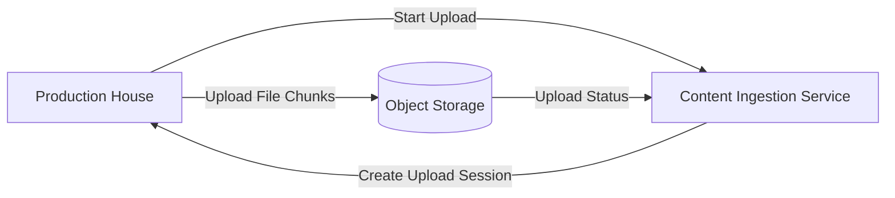
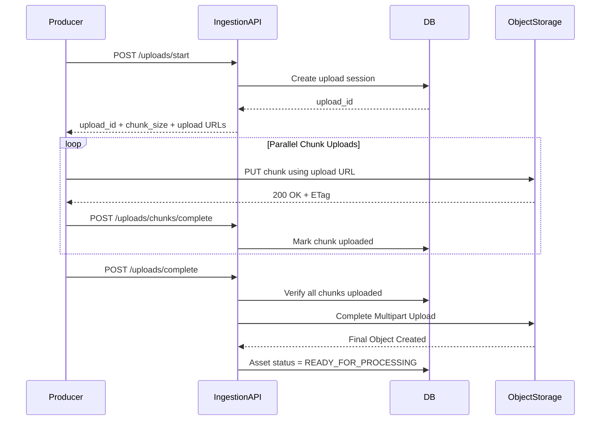
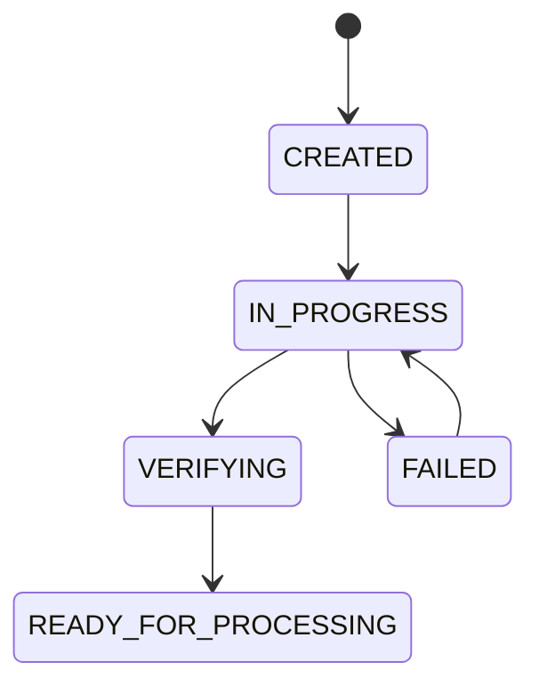
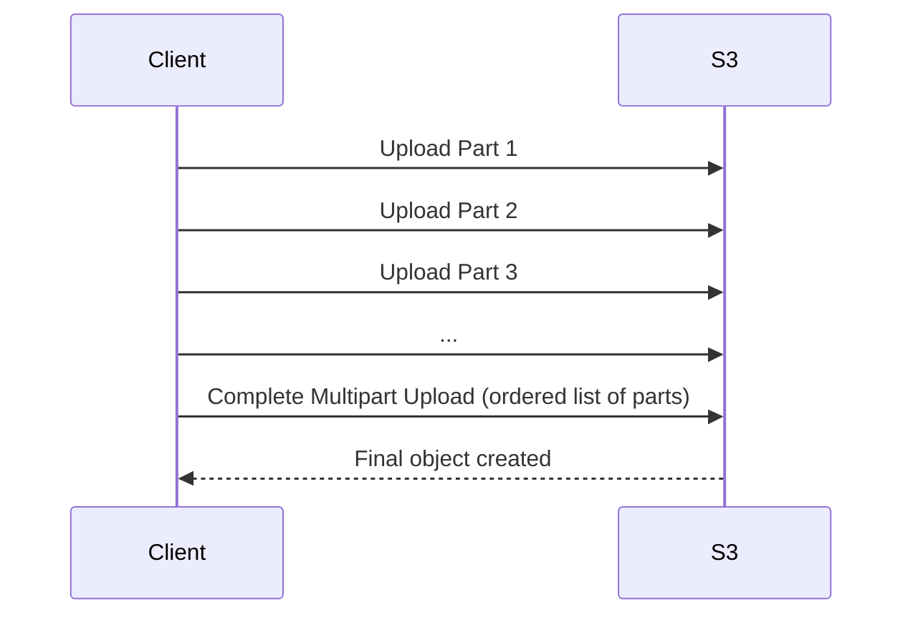

# Netflix System Design — Part 1: Content Upload (Production House → Netflix)

## Goal

Understand how a production house uploads a movie to Netflix before any transcoding or streaming happens.

---

## Step 1 — What does the production house upload?

A production house uploads a **master video asset**, not a consumer MP4.

### Typical Master Video

| Property | Example |
|----------|---------|
| Resolution | 3840×2160 (4K UHD) or 4096×2160 (DCI 4K) |
| Frame Rate | 24 / 30 / 60 FPS |
| Codec | Apple ProRes, DNxHR, RAW |
| Bit Depth | 10-bit / 12-bit |
| File Size | 100–500 GB |

### Resolution vs Quality

| Resolution | Quality (Bitrate) |
|------------|-------------------|
| Number of pixels (720p, 1080p, 4K). | Amount of data stored/transmitted per second of video. |

**Example**

- 4K @ **40 Mbps** → High visual quality.
- 4K @ **8 Mbps** → Same resolution, but more compression.

> Netflix never creates a true resolution higher than the source video. If the source is 1080p, Netflix generates renditions only up to 1080p.

---

## Step 2 — Upload Starts

The production house uploads the master asset using Netflix's **Content Ingestion Service**.

### High-Level Flow



---

## Why Multipart Upload?

A 200 GB file is **not uploaded as one request**.

Instead, it is divided into multiple chunks.

### Benefits

- Retry only failed chunks.
- Upload chunks in parallel.
- Resume upload after network interruption.
- Better throughput over long-distance networks.

---

## What happens at this stage?

1. Producer requests a new upload session.
2. Netflix creates an upload session and returns an `upload_id`.
3. The producer starts uploading chunks associated with that upload session.
4. Netflix tracks which chunks have arrived.
5. After every chunk is uploaded, the file is marked **Ready for Processing**.

---

## We are intentionally skipping these details for now

These deserve their own chapter:

- How chunking actually happens in memory.
- Upload session database schema.
- Checksums and integrity verification.
- Parallel uploads and retries.
- Object storage assembly.
- Resume after interruption.

---


# Netflix System Design — Part 2: Multipart Upload Internals (200 GB Movie Upload)

## Goal

Understand **exactly** how Netflix uploads a 200 GB master video from a production house into its storage system.

This chapter covers only the upload pipeline — from creating an upload session until the final master video is stored in Object Storage.

---

# Functional Requirement

> A production house wants to upload a 200 GB movie to Netflix reliably, even if the network fails midway.

## Non-Functional Requirements

- Upload files of hundreds of GBs or TBs.
- Resume uploads after failures.
- Upload multiple chunks in parallel.
- Verify integrity of every chunk.
- Prevent duplicate uploads during retries.
- Keep application servers free from handling 200 GB of traffic.

---

# High-Level Upload Architecture



---

# Step 1 — Create Upload Session

Before uploading any bytes, the producer creates an upload session.

## API

```http
POST /v1/uploads/start
```

## Request

```json
{
  "title": "Avengers Endgame",
  "file_name": "endgame_master.mov",
  "file_size": 214748364800,
  "content_type": "video/quicktime"
}
```

## Backend Work

The Ingestion Service:

1. Authenticates the production house.
2. Creates an upload session in the database.
3. Calculates chunk configuration.
4. Creates upload URLs for Object Storage.

## Response

```json
{
  "upload_id": "upl_9a81f3",
  "chunk_size": 67108864,
  "total_chunks": 3200,
  "expires_at": "2026-09-20T10:00:00Z",
  "upload_urls": [
    {
      "chunk_number": 1,
      "url": "https://storage.netflix.com/upload?...partNumber=1"
    },
    {
      "chunk_number": 2,
      "url": "https://storage.netflix.com/upload?...partNumber=2"
    }
  ]
}
```

## Why does the server return Upload URLs?

The client uploads **directly to Object Storage** instead of sending 200 GB through the Ingestion API.

**Benefit**

- API servers handle metadata only.
- Object Storage handles heavy network traffic.

---

# Step 2 — Client Splits the File into Chunks

The producer's upload client performs chunking locally.

## Example

```text
Movie Size  = 200 GB
Chunk Size  = 64 MB
Total Chunks = 3200
```

## Chunk Layout

| Chunk | Byte Range |
|-------|------------|
| 1 | 0 → 64 MB |
| 2 | 64 MB → 128 MB |
| 3 | 128 MB → 192 MB |
| ... | ... |
| 3200 | Remaining bytes |

## Important

The client reads **64 MB from disk at a time**.

It never loads the complete 200 GB file into memory.

---

# Step 3 — Parallel Chunk Upload

Instead of uploading sequentially, multiple workers upload chunks simultaneously.

```text
Worker 1 → Chunk 1
Worker 2 → Chunk 2
Worker 3 → Chunk 3
Worker 4 → Chunk 4
Worker 5 → Chunk 5
...
```

## Why parallel uploads?

- Better bandwidth utilization.
- Lower total upload time.
- Failed chunks don't block successful chunks.

Typical concurrency is **4–32 workers**, depending on available bandwidth.

---

# Step 4 — Upload a Chunk to Object Storage

The upload client uses the upload URL received earlier.

## Request

```http
PUT https://storage.netflix.com/upload?...partNumber=15

Body: <64 MB binary data>
```

## Headers

```http
Content-Length: 67108864
Checksum: sha256(...)
```

## Response from Object Storage

```http
HTTP/1.1 200 OK

ETag: "9f6203b8a1..."
```

## What is uploaded?

Only **raw bytes of Chunk 15**.

At this stage there is **no complete movie object**.

---

# Step 5 — Notify Netflix That Chunk Upload Succeeded

Uploading to Object Storage is **not enough**.

The client informs the Ingestion Service after receiving `200 OK`.

## API

```http
POST /v1/uploads/chunks/complete
```

## Request

```json
{
  "upload_id": "upl_9a81f3",
  "chunk_number": 15,
  "etag": "9f6203b8a1...",
  "checksum": "sha256(...)"
}
```

## Backend Work

The Ingestion Service:

- Verifies upload session.
- Stores chunk metadata.
- Marks chunk as uploaded.
- Updates upload progress.

This API is **idempotent**.

Calling it multiple times for the same chunk is safe.

---

# Step 6 — Where Are Chunks Stored?

During upload, chunks are temporary objects.

```text
uploads/
└── upl_9a81f3/
    ├── part-1
    ├── part-2
    ├── part-3
    ├── ...
    └── part-3200
```

The final movie **does not exist yet**.

Object Storage only stores temporary parts.

---

# Step 7 — Metadata Stored by Netflix

## upload_sessions Table

| Column | Purpose |
|--------|---------|
| upload_id | Upload session identifier |
| producer_id | Owner of upload |
| asset_id | Movie identifier |
| file_name | Original uploaded file |
| total_size | File size |
| chunk_size | Size of each chunk |
| total_chunks | Expected chunk count |
| uploaded_chunks | Progress counter |
| status | CREATED / IN_PROGRESS / COMPLETED / FAILED |

## upload_chunks Table

| Column | Purpose |
|--------|---------|
| upload_id | Session reference |
| chunk_number | Chunk index |
| etag | Object Storage ETag |
| checksum | Client checksum |
| size | Uploaded size |
| status | PENDING / UPLOADED |

## Why two tables?

- `upload_sessions` stores overall upload state.
- `upload_chunks` tracks every individual chunk.

---

# Step 8 — Upload Progress

Whenever `/uploads/chunks/complete` succeeds:

```text
uploaded_chunks += 1
```

Progress is calculated as:

```text
uploaded_chunks / total_chunks
```

Example:

| Uploaded Chunks | Progress |
|----------------|----------|
| 800 | 25% |
| 1600 | 50% |
| 2400 | 75% |
| 3200 | 100% |

The producer dashboard simply reads this metadata.

---

# Step 9 — Failure Handling

## Case 1 — Chunk Upload Fails

```text
PUT Chunk 532
      ↓
Network Error
      ↓
Retry PUT Chunk 532
```

No API call is made to Netflix because Object Storage never confirmed success.

---

## Case 2 — Chunk Upload Succeeds but Notification Fails

```text
PUT Chunk 532 → Success ✅

POST /uploads/chunks/complete → Failed ❌
```

The client retries only:

```http
POST /uploads/chunks/complete
```

Since `(upload_id, chunk_number)` is unique, retries are safe.

---

## Case 3 — Resume Upload After Disconnect

Producer reconnects.

### API

```http
GET /v1/uploads/{upload_id}/status
```

### Response

```json
{
  "uploaded_chunks": [1,2,3,...,1850]
}
```

The client uploads only:

```text
1851 → 3200
```

No previously uploaded chunks are sent again.

---

# Step 10 — Complete Multipart Upload

After every chunk is uploaded and recorded:

## API

```http
POST /v1/uploads/complete
```

## Backend Validation

The Ingestion Service checks:

1. Have all expected chunk records been received?
2. Does every chunk have an ETag?
3. Are checksums valid?
4. Does uploaded size equal original file size?

Only then is completion allowed.

---

# Step 11 — Object Storage Assembles the Final Movie

Before completion:

```text
uploads/upl_9a81f3/
    part-1
    part-2
    ...
    part-3200
```

After completion:

```text
assets/
└── movie_8472/
    └── master.mov
```

Object Storage combines the parts **in chunk order** into one immutable object.

Temporary chunk objects are deleted afterwards.

> We'll study how this assembly works internally in Part 3.

---

# Upload Session State Machine



---


## ⭐ Important Note — Upload Chunks vs Streaming Chunks

This is one of the most important concepts in Netflix's upload pipeline.

### There are **two completely different types of chunks**.

| Upload Chunks | Streaming Chunks |
|---------------|------------------|
| Used only during **upload** of the master video. | Used when **users watch** the movie. |
| Fixed-size chunks (for example, **64 MB** each). | Fixed-duration chunks (for example, **2-second** video segments). |
| Created by the **upload client**. | Created by the **transcoding pipeline**. |
| Temporary objects stored during upload. | Permanent streaming assets stored for playback. |
| Never served to users. | Always served to users. |

### Intuition

- **Upload chunks** solve a **network reliability problem** (resume uploads, retries, parallel uploads).
- **Streaming chunks** solve a **video playback problem** (adaptive quality, seeking, buffering).

**Rule to remember:** Multipart upload chunks are an upload optimization, not a streaming format.

---

# How Does S3/Object Storage Assemble the Chunks?

This is **not automatic**.

The client explicitly tells Object Storage to assemble the uploaded parts after every chunk has been uploaded successfully.

### Step-by-Step



### What does S3 store while uploading?

Temporary parts:

```text
Upload Session (upload_id = upl_9a81f3)

Part 1
Part 2
Part 3
...
Part 3200
```

Each uploaded part gets an **ETag** (its identifier inside S3).

### Complete Multipart Upload Request

The client sends the **ordered list** of uploaded parts.

```json
{
  "upload_id": "upl_9a81f3",
  "parts": [
    { "part_number": 1, "etag": "etag1" },
    { "part_number": 2, "etag": "etag2" },
    { "part_number": 3, "etag": "etag3" }
  ]
}
```

### How does S3 know the order?

**Order is determined by `part_number`, not upload time.**

Even if:

| Upload Order | Part Number |
|--------------|-------------|
| First uploaded | 5 |
| Second uploaded | 2 |
| Third uploaded | 1 |

S3 creates the final object as:

```text
Part 1 + Part 2 + Part 5
```

because the completion request specifies the order.

### Does S3 copy all 200 GB again?

**No.**

Conceptually, S3 already has every uploaded part stored internally.

During **Complete Multipart Upload**, S3 creates a **new object metadata entry** that references the uploaded parts in the specified order and exposes them as one logical object (`master.mov`). The multipart upload is finalized, and the temporary upload parts are removed.

> From the client's perspective, it instantly becomes one 200 GB object without re-uploading the data.

### Final Result

Before completion:

```text
Multipart Upload
├── Part 1
├── Part 2
├── Part 3
└── Part 3200
```

After completion:

```text
assets/
└── movie_8472/
    └── master.mov (200 GB)
```

Multipart upload parts are temporary storage used only during upload. After CompleteMultipartUpload, S3 reconstructs the original binary file (master.mov) and removes the temporary parts. So the file master.mov has all the info regarding all the parts that we have in S3 as a single object file.

The application now reads `master.mov` like a normal file, without knowing multipart upload was ever used.

# What happens after Completion

This is for maintaining the durability of the file:

master.mov (200 GB)
        │
        ├── Stored across multiple storage nodes
        ├── Replicated / Erasure Coded
        └── Metadata tracks where each data block lives


# Failure Scenarios

| Scenario | Netflix Behavior |
|----------|------------------|
| Network disconnect during upload | Resume remaining chunks. |
| Duplicate chunk upload | Safe because chunk completion API is idempotent. |
| Missing chunk | `/uploads/complete` fails validation. |
| Invalid checksum | Chunk is rejected and must be re-uploaded. |
| Upload session expired | Upload URLs become invalid and a new session is required. |

---

# Key Takeaways

- The **client** performs chunking locally.
- The Ingestion API creates an **upload session** and returns **upload URLs**.
- Chunks are uploaded **directly to Object Storage**, not through API servers.
- After every successful upload, the client calls **`/uploads/chunks/complete`** so Netflix records metadata.
- Failed uploads retry **only the failed chunk**.
- The final movie object is created only after **`/uploads/complete`** succeeds.
- At this point, Netflix has one uploaded **master video** ready for processing.

---

# Next Chapter

## Part 3 — Object Storage Internals

We'll deep dive into:

- What exactly Object Storage is.
- How multipart assembly works internally.
- ETags and checksum verification.
- Physical storage, replication, and durability.
- Why Netflix uses Object Storage instead of MySQL or Redis.