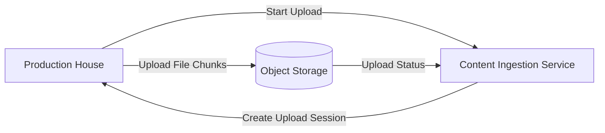

# Netflix System Design — Part 1: Content Upload (Production House → Netflix)

## Goal

Understand how a production house uploads a movie to Netflix before any transcoding or streaming happens.

---

## Step 1 — What does the production house upload?

A production house uploads a **master video asset**, not a consumer MP4.

### Typical Master Video

| Property | Example |
|----------|---------|
| Resolution | 3840×2160 (4K UHD) or 4096×2160 (DCI 4K) |
| Frame Rate | 24 / 30 / 60 FPS |
| Codec | Apple ProRes, DNxHR, RAW |
| Bit Depth | 10-bit / 12-bit |
| File Size | 100–500 GB |

### Resolution vs Quality

| Resolution | Quality (Bitrate) |
|------------|-------------------|
| Number of pixels (720p, 1080p, 4K). | Amount of data stored/transmitted per second of video. |

**Example**

- 4K @ **40 Mbps** → High visual quality.
- 4K @ **8 Mbps** → Same resolution, but more compression.

> Netflix never creates a true resolution higher than the source video. If the source is 1080p, Netflix generates renditions only up to 1080p.

---

## Step 2 — Upload Starts

The production house uploads the master asset using Netflix's **Content Ingestion Service**.

### High-Level Flow

---

## Why Multipart Upload?

A 200 GB file is **not uploaded as one request**.

Instead, it is divided into multiple chunks.

### Benefits

- Retry only failed chunks.
- Upload chunks in parallel.
- Resume upload after network interruption.
- Better throughput over long-distance networks.

---

## What happens at this stage?

1. Producer requests a new upload session.
2. Netflix creates an upload session and returns an `upload_id`.
3. The producer starts uploading chunks associated with that upload session.
4. Netflix tracks which chunks have arrived.
5. After every chunk is uploaded, the file is marked **Ready for Processing**.

---

## We are intentionally skipping these details for now

These deserve their own chapter:

- How chunking actually happens in memory.
- Upload session database schema.
- Checksums and integrity verification.
- Parallel uploads and retries.
- Object storage assembly.
- Resume after interruption.

---

## Next Part

**Part 2 — Multipart Upload Internals**

We'll deep dive into the complete multipart upload implementation used by large-scale systems like Netflix.