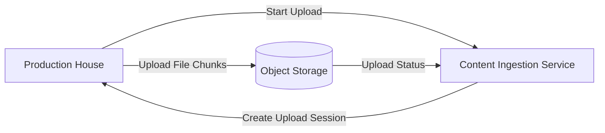
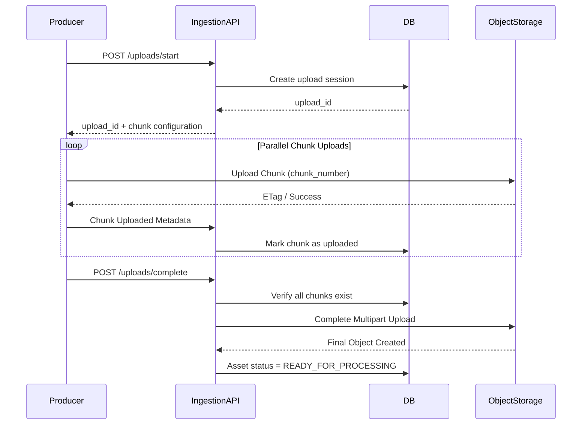
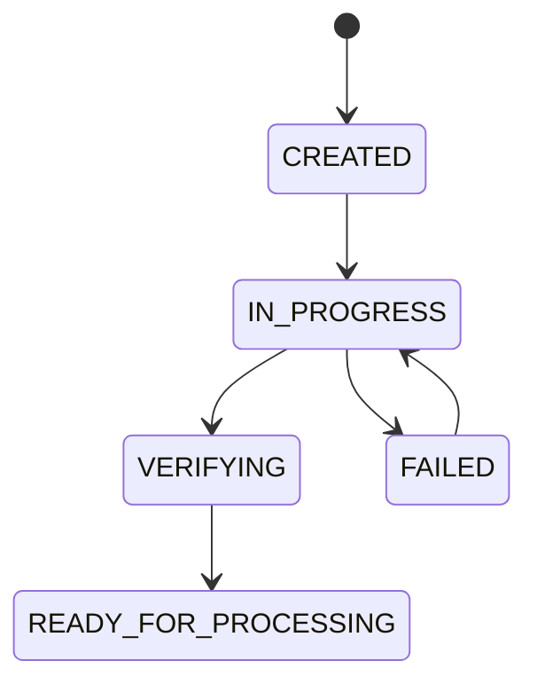

# Netflix System Design — Part 1: Content Upload (Production House → Netflix)

## Goal

Understand how a production house uploads a movie to Netflix before any transcoding or streaming happens.

---

## Step 1 — What does the production house upload?

A production house uploads a **master video asset**, not a consumer MP4.

### Typical Master Video

| Property | Example |
|----------|---------|
| Resolution | 3840×2160 (4K UHD) or 4096×2160 (DCI 4K) |
| Frame Rate | 24 / 30 / 60 FPS |
| Codec | Apple ProRes, DNxHR, RAW |
| Bit Depth | 10-bit / 12-bit |
| File Size | 100–500 GB |

### Resolution vs Quality

| Resolution | Quality (Bitrate) |
|------------|-------------------|
| Number of pixels (720p, 1080p, 4K). | Amount of data stored/transmitted per second of video. |

**Example**

- 4K @ **40 Mbps** → High visual quality.
- 4K @ **8 Mbps** → Same resolution, but more compression.

> Netflix never creates a true resolution higher than the source video. If the source is 1080p, Netflix generates renditions only up to 1080p.

---

## Step 2 — Upload Starts

The production house uploads the master asset using Netflix's **Content Ingestion Service**.

### High-Level Flow



---

## Why Multipart Upload?

A 200 GB file is **not uploaded as one request**.

Instead, it is divided into multiple chunks.

### Benefits

- Retry only failed chunks.
- Upload chunks in parallel.
- Resume upload after network interruption.
- Better throughput over long-distance networks.

---

## What happens at this stage?

1. Producer requests a new upload session.
2. Netflix creates an upload session and returns an `upload_id`.
3. The producer starts uploading chunks associated with that upload session.
4. Netflix tracks which chunks have arrived.
5. After every chunk is uploaded, the file is marked **Ready for Processing**.

---

## We are intentionally skipping these details for now

These deserve their own chapter:

- How chunking actually happens in memory.
- Upload session database schema.
- Checksums and integrity verification.
- Parallel uploads and retries.
- Object storage assembly.
- Resume after interruption.

---


# Netflix System Design — Part 2: Multipart Upload Internals (200 GB Movie Upload)

## Goal

Understand **exactly** how Netflix uploads a 200 GB master video from a production house into its storage system.

This chapter covers only the upload process — no transcoding or streaming yet.

---

# Functional Requirement

> A production house wants to upload a 200 GB movie to Netflix reliably, even if the network fails midway.

### Non-Functional Requirements

- Support files of hundreds of GBs or even TBs.
- Resume upload after failures.
- Upload chunks in parallel for high throughput.
- Verify file integrity.
- Handle duplicate/retried chunk uploads safely.

---

# Complete Upload Flow



---

# Step 1 — Start Upload Session

The producer **does not upload the file immediately**.

First, it requests an upload session.

### API

```http
POST /v1/uploads/start
```

### Request

```json
{
  "title": "Avengers Endgame",
  "file_name": "endgame_master.mov",
  "file_size": 214748364800,
  "content_type": "video/quicktime"
}
```

### Response

```json
{
  "upload_id": "upl_9a81f3",
  "chunk_size": 67108864,
  "total_chunks": 3200,
  "expires_at": "2026-09-20T10:00:00Z"
}
```

### Why create an upload session?

The upload session becomes the **single source of truth** for this upload.

It stores:

- Who is uploading.
- Which movie.
- Total file size.
- Chunk size.
- Upload status.
- Progress.

---

# Step 2 — How is the 200 GB file split?

The **client application** running at the production house splits the file.

Netflix's server never downloads the entire file first.

## Example

```
Movie Size = 200 GB

Chunk Size = 64 MB

Total Chunks = 200 GB / 64 MB = 3200 chunks
```

### Chunk Layout

| Chunk Number | Byte Range |
|--------------|-----------|
| 1 | 0 → 64 MB |
| 2 | 64 MB → 128 MB |
| 3 | 128 MB → 192 MB |
| ... | ... |
| 3200 | Last remaining bytes |

### Important

The client reads **64 MB at a time from disk**.

It does **not** load the 200 GB file into RAM.

---

# Step 3 — Upload Chunks in Parallel

Instead of uploading sequentially:

```
Chunk1
Chunk2
Chunk3
...
```

The client uploads multiple chunks simultaneously.

```text
Worker 1 → Chunk 1
Worker 2 → Chunk 2
Worker 3 → Chunk 3
Worker 4 → Chunk 4
Worker 5 → Chunk 5
...
```

### Why parallel uploads?

- Better bandwidth utilization.
- Faster upload over high-latency networks.
- Independent retries.

### Typical Parallelism

- 4–32 concurrent uploads depending on bandwidth.
- Chunk size stays fixed.

---

# Step 4 — Uploading a Chunk

Each chunk is uploaded independently.

### API Concept

```http
PUT /v1/uploads/{upload_id}/chunks/{chunk_number}
```

Headers contain:

```http
Chunk-Number: 15
Content-Length: 67108864
Checksum: sha256(...)
```

Body contains only **64 MB of bytes**.

### Server receives

- upload_id
- chunk_number
- checksum
- chunk bytes

---

# Where is the chunk stored?

The chunk is stored **directly in Object Storage**.

Example logical path:

```
uploads/upl_9a81f3/part-15
```

At this stage there is **no final movie object yet**.

Only temporary chunk objects exist.

---

# Step 5 — Track Chunk Metadata

Netflix keeps metadata in a database.

## upload_sessions Table

| Column | Purpose |
|--------|---------|
| upload_id | Unique upload session |
| producer_id | Who uploaded |
| file_name | Original file |
| total_size | 200 GB |
| chunk_size | 64 MB |
| total_chunks | 3200 |
| uploaded_chunks | Counter |
| status | IN_PROGRESS / COMPLETED |

## upload_chunks Table

| Column | Purpose |
|--------|---------|
| upload_id | Session reference |
| chunk_number | 1…3200 |
| checksum | SHA256/MD5 |
| etag | Storage identifier |
| size | Chunk size |
| status | PENDING / UPLOADED |

### Why a separate chunk table?

Because every chunk is tracked independently.

---

# Step 6 — How does Netflix know upload progress?

Whenever a chunk succeeds:

```text
uploaded_chunks += 1
```

Progress becomes

```
uploaded_chunks / total_chunks
```

Example:

| Uploaded | Progress |
|----------|----------|
| 800 | 25% |
| 1600 | 50% |
| 2400 | 75% |
| 3200 | 100% |

The producer dashboard simply reads this metadata.

---

# Step 7 — What if Chunk 532 fails?

Only that chunk is retried.

```text
Chunk 531 ✅
Chunk 532 ❌ Retry
Chunk 533 ✅
Chunk 534 ✅
```

Nothing else is uploaded again.

### Why?

Each chunk is independent and identified by:

```
(upload_id, chunk_number)
```

This makes retries **idempotent**.

Uploading Chunk 532 twice simply replaces or ignores the previous copy.

---

# Step 8 — Resume After Network Failure

Suppose upload stopped at **Chunk 1850**.

Producer reconnects.

### API

```http
GET /v1/uploads/{upload_id}/status
```

### Response

```json
{
  "uploaded_chunks": [
    1,
    2,
    3,
    ...
    1850
  ]
}
```

The client uploads only:

```
1851 → 3200
```

No previous chunks are re-uploaded.

---

# Step 9 — Complete Multipart Upload

After all chunks are uploaded:

### API

```http
POST /v1/uploads/{upload_id}/complete
```

### Backend Validation

1. Are all 3200 chunks present?
2. Is every checksum valid?
3. Is total uploaded size exactly 200 GB?

If yes:

The ingestion service instructs object storage to **assemble** the chunks.

---

# What happens inside Object Storage?

Temporary chunks:

```text
uploads/upl_9a81f3/
    part-1
    part-2
    part-3
    ...
    part-3200
```

After completion:

```text
assets/movie_8472/master.mov
```

The storage service concatenates chunks **in order** into one immutable object.

Temporary parts are deleted afterwards.

---

# State Machine



---

# Failure Scenarios

| Scenario | Netflix Behavior |
|----------|------------------|
| Network disconnect | Resume remaining chunks. |
| Duplicate chunk upload | Safe because upload is idempotent. |
| Missing chunk | Completion request fails. |
| Wrong checksum | Chunk rejected and re-upload requested. |
| Upload session expired | New upload session required. |

---

# Key Takeaways

- The **client** splits the 200 GB file into chunks.
- Chunks are uploaded **directly to object storage** in parallel.
- Netflix stores upload progress in metadata tables.
- Retries happen **per chunk**, not for the whole file.
- The final movie object is created **only after** all chunks are verified.

---

# Next Chapter

## Part 3 — Object Storage Internals

We'll answer:

- What exactly is Object Storage (S3/Open Connect storage)?
- How does multipart assembly happen internally?
- What is an ETag?
- How are replicas stored across data centers?
- Why doesn't Netflix store movies in MySQL or Redis?