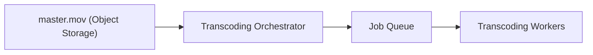
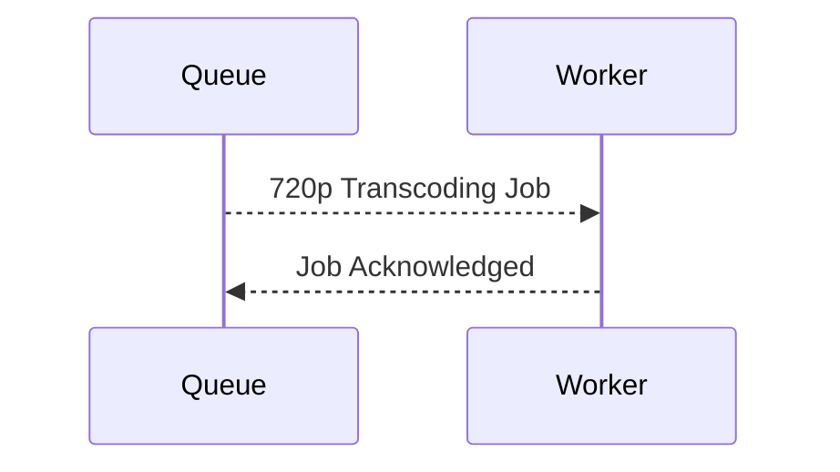

# Netflix System Design — Part 4: Transcoding Pipeline Internals

## Goal

Understand how Netflix converts a single uploaded **master video (`master.mov`)** into multiple streaming-ready video versions (240p, 360p, 720p, 1080p, 4K).

> **Scope:** This chapter covers only how the transcoding pipeline starts and how jobs are created. We will cover FFmpeg, segmentation, audio, subtitles, and HDR in the next sections.

---

# Where We Left Off

After Part 3, we have one durable object stored in Object Storage.

```text
assets/
└── movie_8472/
    └── master.mov (200 GB)
```

The upload is complete, but users still **cannot stream** this movie.

**Why?**

- It exists in only one master format.
- There are no lower-quality versions.
- There are no streaming segments.
- There are no manifests.

The next step is **transcoding**.

---

# What is Transcoding?

**Transcoding** is the process of converting one master video into multiple video renditions optimized for streaming.

### Example

| Input | Outputs |
|-------|---------|
| `master.mov` (4K ProRes, 200 GB) | 240p, 360p, 480p, 720p, 1080p, 4K (H.264/H.265) |

### Why is it needed?

Different users have different:

- Internet speeds.
- Devices.
- Screen resolutions.

Netflix prepares multiple versions before anyone starts watching.

---

# High-Level Pipeline



---

# Step 1 — Upload Completion Triggers the Pipeline

The upload service finishes multipart upload.

## Backend Flow

1. Upload session becomes `READY_FOR_PROCESSING`.
2. Asset metadata is updated.
3. A transcoding job is created.

### State Change

| Stage | Status |
|-------|--------|
| Uploading | `IN_PROGRESS` |
| Upload Complete | `READY_FOR_PROCESSING` |
| Transcoding Started | `TRANSCODING` |

---

# Step 2 — Transcoding Orchestrator

A dedicated backend service is responsible for starting processing.

### Responsibilities

- Read newly uploaded assets.
- Decide which renditions to generate.
- Create transcoding jobs.
- Push jobs into a queue.

> It does **not** process video itself.

---

# Step 3 — Create Jobs

Suppose the uploaded movie is available in 4K HDR.

The orchestrator creates independent jobs.

| Job | Output |
|-----|--------|
| Job 1 | 240p |
| Job 2 | 360p |
| Job 3 | 480p |
| Job 4 | 720p |
| Job 5 | 1080p |
| Job 6 | 4K HDR |

Each rendition becomes a separate processing task.

---

# Why Separate Jobs?

Instead of one huge transcoding task:

```text
master.mov
    ↓
Everything
```

Netflix creates parallel jobs.

```text
master.mov
   ├── 240p Job
   ├── 360p Job
   ├── 480p Job
   ├── 720p Job
   ├── 1080p Job
   └── 4K Job
```

### Benefits

- Jobs run in parallel.
- Failure of one rendition doesn't affect others.
- Workers can scale independently.

---

# Step 4 — Job Queue

The orchestrator publishes jobs to a distributed queue.

### Example Job Message

```json
{
  "job_id": "job_78291",
  "asset_id": "movie_8472",
  "object_key": "assets/movie_8472/master.mov",
  "target_resolution": "720p",
  "codec": "H264",
  "bitrate": "5 Mbps"
}
```

### Why Use a Queue?

- Decouples upload service from transcoding.
- Buffers thousands of uploaded movies.
- Workers consume jobs at their own speed.

---

# Step 5 — Transcoding Workers

Workers continuously poll the queue.



Each worker processes **one job**.

Examples:

| Worker | Processing |
|--------|------------|
| Worker A | 240p |
| Worker B | 720p |
| Worker C | 1080p |
| Worker D | 4K HDR |

Workers are stateless and horizontally scalable.

---

# What Happens Next?

A worker has received a job.

Its next task is to:

1. Read `master.mov` from Object Storage.
2. Decode the video.
3. Encode it into the target resolution and codec.
4. Upload the generated rendition back to Object Storage.

This is the next section.

---

# Key Takeaways

- Upload completion **does not** immediately create streaming files.
- A **Transcoding Orchestrator** starts the processing pipeline.
- Every output resolution is a separate job.
- Jobs are placed into a distributed queue.
- Stateless transcoding workers consume jobs independently.

---

# Next Section

## Part 4.2 — FFmpeg Worker Internals

We'll answer:

- Does the worker download the entire 200 GB movie?
- How does FFmpeg read from Object Storage?
- How are decoding and encoding performed?
- How much RAM and CPU does one worker use?