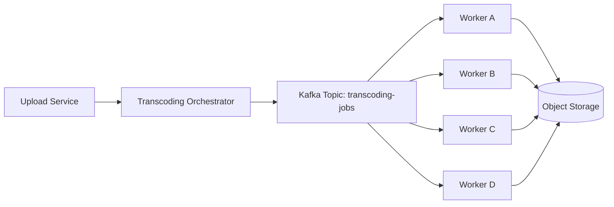
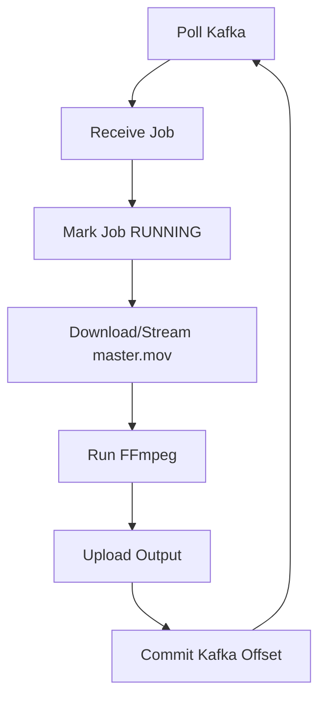
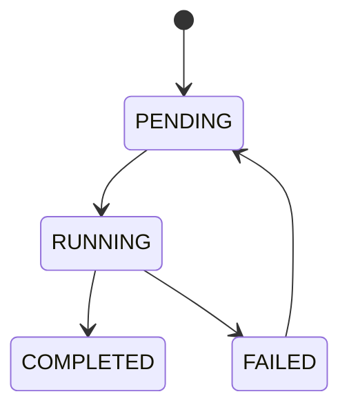
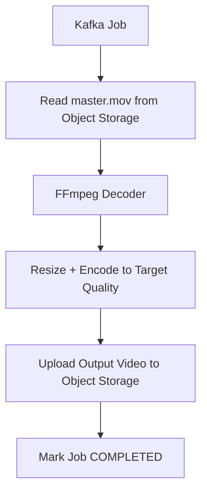
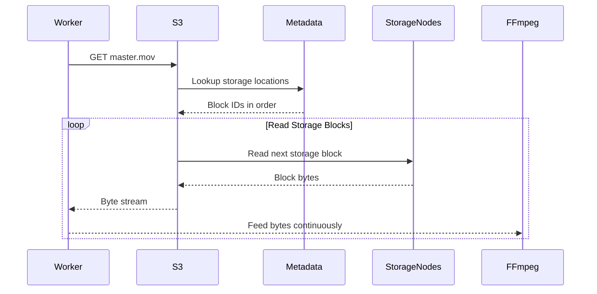
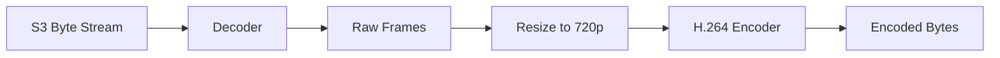
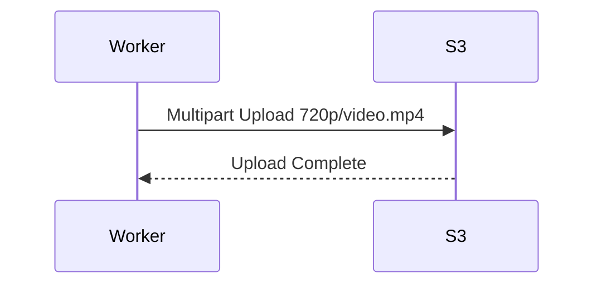
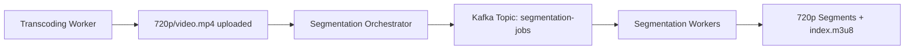

# Netflix System Design — Part 4: Transcoding Pipeline Internals

## Goal

Understand how Netflix converts one uploaded **master video (`master.mov`)** into multiple streaming-ready versions (240p, 360p, 480p, 720p, 1080p, 4K).

This chapter covers the **entire orchestration pipeline**:

- Who starts transcoding?
- How jobs are created.
- Why Kafka is used.
- How workers consume jobs.
- How failures and retries work.
- What happens before FFmpeg starts processing.

> **Scope:** We stop just before FFmpeg begins transcoding. FFmpeg internals are Part 5.

---

# Where We Left Off

After multipart upload completes, Object Storage contains one durable object.

```text
assets/
└── movie_8472/
    └── master.mov (200 GB)
```

The upload service marks the asset as:

```text
READY_FOR_PROCESSING
```

Users still **cannot stream** this movie because only one master asset exists.

---

# High-Level Architecture



---

# Step 1 — Upload Completion Triggers Transcoding

When `/uploads/complete` succeeds:

### Backend Flow

1. Multipart upload finishes.
2. `master.mov` is created in Object Storage.
3. Asset metadata is updated.
4. Upload service calls the **Transcoding Orchestrator**.

### Asset State

| Stage | Status |
|-------|--------|
| Uploading | `IN_PROGRESS` |
| Upload Finished | `READY_FOR_PROCESSING` |
| Jobs Created | `TRANSCODING` |

**Important**

The upload service **does not** start transcoding itself.

Its only responsibility is to notify the orchestrator.

---

# Step 2 — Transcoding Orchestrator

The orchestrator is a stateless backend service.

## Responsibilities

- Read uploaded asset metadata.
- Decide which renditions need to be generated.
- Create transcoding jobs.
- Publish jobs to Kafka.
- Update asset state.

It never processes video bytes.

---

# Step 3 — Decide Which Renditions to Generate

Suppose the uploaded movie is **4K HDR**.

Netflix creates one job for every required rendition.

| Rendition | Codec | Bitrate |
|-----------|-------|---------|
| 240p | H.264 | 300 kbps |
| 360p | H.264 | 700 kbps |
| 480p | H.264 | 1.2 Mbps |
| 720p | H.264 | 3 Mbps |
| 1080p | H.264 | 5 Mbps |
| 4K HDR | H.265 | 15–25 Mbps |

### Important

One uploaded movie becomes **multiple independent jobs**.

---

# Step 4 — Publish Jobs to Kafka

The orchestrator acts as a **Kafka Producer**.

## Topic

```text
Topic Name: transcoding-jobs
```

### Messages Published

```json
{
  "job_id": "job_240p",
  "asset_id": "movie_8472",
  "object_key": "assets/movie_8472/master.mov",
  "target_resolution": "240p",
  "codec": "H264",
  "bitrate": "300kbps"
}
```

Another message:

```json
{
  "job_id": "job_720p",
  "asset_id": "movie_8472",
  "object_key": "assets/movie_8472/master.mov",
  "target_resolution": "720p",
  "codec": "H264",
  "bitrate": "3Mbps"
}
```

### Kafka Topic After Publishing

```text
transcoding-jobs

Offset 0 → 240p Job
Offset 1 → 360p Job
Offset 2 → 480p Job
Offset 3 → 720p Job
Offset 4 → 1080p Job
Offset 5 → 4K HDR Job
```

Kafka stores these messages until workers consume them.

---

# Why Kafka Instead of Calling Workers Directly?

| Direct API Call | Kafka |
|-----------------|-------|
| Upload service waits for workers. | Upload service publishes and returns immediately. |
| Workers must already exist. | Workers consume whenever available. |
| Tight coupling. | Loose coupling. |
| Difficult retries. | Built-in retry through offsets. |
| Poor scalability. | Thousands of workers can consume jobs. |

**Intuition**

Kafka acts as a durable buffer between upload and transcoding.

---

# Step 5 — Kafka Partitions

Suppose Netflix has many uploaded movies.

```text
Topic: transcoding-jobs

Partition 0
Partition 1
Partition 2
Partition 3
```

### Example Distribution

```text
P0
Movie1-240p
Movie2-720p

P1
Movie1-360p
Movie3-1080p

P2
Movie1-480p
Movie4-4K

P3
Movie1-720p
Movie2-240p
```

### Why Partitions?

- Many workers can consume simultaneously.
- Jobs are distributed across machines.

**Partition Key**

Usually `job_id` (or another unique job identifier), so jobs are spread evenly across partitions.

---

# Step 6 — Consumer Group

All transcoding workers belong to one consumer group.

```text
Consumer Group

transcoding-workers
```

Workers:

```text
Worker A
Worker B
Worker C
Worker D
```

Kafka assigns partitions.

| Worker | Assigned Partitions |
|--------|----------------------|
| Worker A | Partition 0 |
| Worker B | Partition 1 |
| Worker C | Partition 2 |
| Worker D | Partition 3 |

Each message is processed by **exactly one worker** within the consumer group.

---

# Important Question — Does Every Quality Have Its Own Worker?

**No.**

Workers are **generic transcoding workers**.

Any worker can process any rendition.

### Example

| Worker | Job Picked |
|--------|------------|
| Worker A | Movie1 → 240p |
| Worker B | Movie1 → 360p |
| Worker C | Movie2 → 720p |
| Worker D | Movie1 → 4K |

Workers do **not** specialize in 240p or 720p.

The job message tells the worker what to produce.

### Why?

- Better load balancing.
- Easy horizontal scaling.
- Workers remain stateless.

---

# Step 7 — Worker Lifecycle

Every worker runs an infinite polling loop.



### Step-by-Step

1. Poll Kafka.
2. Receive one job.
3. Mark status as `RUNNING`.
4. Read input movie.
5. Transcode.
6. Upload result.
7. Commit Kafka offset.

Then poll for the next job.

---

# Step 8 — Job Status Tracking

Netflix stores job metadata separately.

## transcoding_jobs Table

| Column | Purpose |
|--------|---------|
| job_id | Unique transcoding job |
| asset_id | Movie being processed |
| rendition | 720p / 1080p / 4K |
| status | PENDING / RUNNING / COMPLETED / FAILED |
| worker_id | Worker processing it |
| retry_count | Retry attempts |
| output_key | Final storage location |

### State Machine



---

# Step 9 — What Happens If A Worker Crashes?

Example:

```text
Worker B receives 720p job.

Starts processing.

Machine crashes.
```

### Kafka Behavior

The worker never commits its offset.

Kafka still considers the message **unprocessed**.

After a timeout:

```text
Worker D receives the same job.
```

The job is executed again.

No manual retry is needed.

---

# Step 10 — Offset Commit (Very Important)

### Wrong Order ❌

```text
Receive Job
Commit Offset
Start FFmpeg
Crash
```

Job is permanently lost.

### Correct Order ✅

```text
Receive Job
Start FFmpeg
Upload Output
Commit Offset
```

Kafka offset is committed **only after successful upload**.

This guarantees **at-least-once processing**.

---

# Step 11 — Why Is Duplicate Processing Safe?

Suppose Worker B crashes after uploading output but before committing offset.

Worker D receives the same job.

Two workers may attempt the same rendition.

### Why Safe?

Every job has a unique `job_id`.

Workers write output to a deterministic path.

Example:

```text
assets/movie_8472/renditions/720p/video.mp4
```

The storage layer or job table ensures duplicate completion is ignored or safely overwritten.

This makes transcoding **idempotent**.

---

# Step 12 — What Happens After A Job Completes?

Worker uploads the generated rendition.

Example:

```text
assets/movie_8472/renditions/

240p/video.mp4
360p/video.mp4
480p/video.mp4
720p/video.mp4
1080p/video.mp4
4k/video.mp4
```

The worker updates the job table.

```text
Status = COMPLETED
```

The orchestrator waits until **all required rendition jobs** finish before moving the asset to the next pipeline stage.

---

# Failure Scenarios

| Scenario | Netflix Behavior |
|----------|------------------|
| Worker crashes before offset commit | Kafka redelivers the job. |
| Worker crashes after upload but before commit | Duplicate job runs safely (idempotent). |
| FFmpeg fails due to corrupt input | Job marked FAILED and retried. |
| Kafka unavailable temporarily | Orchestrator retries publishing jobs. |
| One rendition fails (720p) | Other renditions continue processing independently. |

---

# Key Takeaways

- The **Upload Service** only signals that `master.mov` is ready.
- A **Transcoding Orchestrator** creates one job for each required rendition.
- The orchestrator is a **Kafka producer** and publishes jobs to `transcoding-jobs`.
- Kafka partitions distribute jobs across many workers.
- Workers are **generic**; they can process any resolution based on the job message.
- Workers commit Kafka offsets **only after** the output rendition is successfully uploaded.
- Jobs are **idempotent**, so retries and duplicate deliveries are safe.
- After all rendition jobs complete, Netflix proceeds to the segmentation pipeline.

---

# Next Chapter

## Part 5 — FFmpeg Worker Internals

We'll answer:

- Does a worker download the full 200 GB movie?
- How does it stream bytes from Object Storage?
- How FFmpeg decodes, scales, and encodes video.
- CPU, memory, disk, and parallel processing inside a transcoding worker.


# Netflix System Design — Part 5: FFmpeg Worker Internals (How One Rendition Is Created)

## Goal

Understand what happens **inside one transcoding worker** after it receives a Kafka job.

This chapter answers:

- Does the worker download the entire 200 GB movie?
- How does it read from Object Storage?
- How does FFmpeg decode and encode video?
- How are CPU, RAM, and disk used?
- What is uploaded after transcoding finishes?

> **Scope:** We cover only one worker processing one rendition (for example, 720p). Segmentation into HLS/DASH chunks comes in the next chapter.

---

# Where We Left Off

A worker receives one Kafka job.

```json
{
  "job_id": "job_720p",
  "asset_id": "movie_8472",
  "object_key": "assets/movie_8472/master.mov",
  "target_resolution": "720p",
  "codec": "H264",
  "bitrate": "3Mbps"
}
```

The worker's responsibility is to produce:

```text
720p/video.mp4
```

---

# High-Level Worker Flow



---

# Step 1 — Worker Reads `master.mov`

The worker receives only the **object key**.

```text
assets/movie_8472/master.mov
```

### Question: Does it download the entire 200 GB first?

**No.**

The worker streams the object from Object Storage.

---

# Streaming From Object Storage

The worker issues a normal object read.

```http
GET /assets/movie_8472/master.mov
```

Object Storage returns a **continuous byte stream**.

```text
Storage Blocks
      ↓
Object Storage
      ↓
Continuous Binary Stream
      ↓
FFmpeg
```

### Why streaming instead of downloading?

- Doesn't require 200 GB RAM.
- Doesn't wait for the full file before processing.
- Starts decoding immediately.

---

# Step 2 — How FFmpeg Reads the Stream

FFmpeg consumes the incoming bytes sequentially.

```text
Object Storage Stream
        │
        ▼
Decoder Buffer
        ▼
Video Frames
```

FFmpeg maintains an internal read buffer.

### Important

- It reads a small portion of bytes.
- Decodes those bytes into frames.
- Requests more bytes as needed.

It does **not** load the complete movie into memory.

---

# Step 3 — Decode the Video

The uploaded movie is usually stored in a high-quality codec like ProRes.

FFmpeg first **decodes** compressed bytes into raw frames.

### Input

```text
Compressed Video Bytes
```

### Output

```text
Frame 1
Frame 2
Frame 3
Frame 4
...
```

### Intuition

A video is essentially a sequence of images.

For a 24 FPS movie:

```text
1 second = 24 frames
```

A 2-hour movie contains more than **170,000 frames**.

---

# Step 4 — Scale Frames

The worker is processing the **720p** job.

Each decoded frame is resized.

```text
Original Frame

3840 × 2160

        ↓

1280 × 720
```

Every frame is resized independently.

### Different Workers Produce Different Sizes

| Job | Output Resolution |
|------|-------------------|
| 240p | 426 × 240 |
| 360p | 640 × 360 |
| 480p | 854 × 480 |
| 720p | 1280 × 720 |
| 1080p | 1920 × 1080 |
| 4K | 3840 × 2160 |

---

# Step 5 — Encode the Frames

Resized frames are encoded into a streaming codec.

Example:

| Input Codec | Output Codec |
|-------------|--------------|
| ProRes | H.264 |
| ProRes HDR | H.265 |

### Why Encode Again?

Raw frames are enormous.

Encoding compresses them dramatically.

Example:

| Stage | Approx Size |
|-------|-------------|
| Raw decoded frames | Several TB |
| Encoded 720p video | Few GB |

---

# Step 6 — Apply Target Bitrate

Resolution is not enough.

The worker also applies bitrate.

### Example

| Rendition | Bitrate |
|-----------|---------|
| 240p | 300 kbps |
| 720p | 3 Mbps |
| 1080p | 5 Mbps |
| 4K HDR | 18 Mbps |

### Why?

Bitrate controls visual quality and file size.

Higher bitrate means more information per second.

---

# Step 7 — CPU, RAM, and Disk Usage

### CPU

Encoding is CPU-intensive.

Most CPU time is spent compressing frames.

### RAM

RAM stores only:

- Decoder buffers.
- A few frames being processed.
- Encoder buffers.

**Not** the whole movie.

### Disk

Workers usually write intermediate output to local SSD.

```text
Local SSD

/tmp/job_720p/output.mp4
```

Why?

Encoding continuously writes bytes before upload.

---

# Step 8 — Upload Output to Object Storage

After encoding finishes:

```text
output.mp4
```

Worker uploads it.

### Object Storage Path

```text
assets/movie_8472/renditions/

720p/video.mp4
```

Every rendition has its own folder.

Example:

```text
renditions/

240p/video.mp4
360p/video.mp4
480p/video.mp4
720p/video.mp4
1080p/video.mp4
4k/video.mp4
```

---

# Step 9 — Update Job Status

Worker updates metadata.

## transcoding_jobs

| Field | Value |
|-------|-------|
| job_id | job_720p |
| status | COMPLETED |
| output_key | renditions/720p/video.mp4 |
| completed_at | Timestamp |

Only after this succeeds does the worker commit the Kafka offset.

---

# What Happens If Upload Fails?

```text
Encoding Finished ✅

Upload Failed ❌
```

### Worker Behavior

- Retry upload.
- Do **not** commit Kafka offset.
- If worker crashes, Kafka redelivers the job.

No rendition is lost.

---

# Failure Scenarios

| Scenario | Worker Behavior |
|----------|-----------------|
| Object Storage temporarily unavailable | Retry upload. |
| FFmpeg crashes during encoding | Job marked FAILED and retried. |
| Worker machine crashes before upload | Kafka redelivers job. |
| Worker crashes after upload but before offset commit | Duplicate processing is safe (idempotent output path). |

---

# End State After All Workers Finish

Object Storage now contains multiple encoded videos.

```text
assets/
└── movie_8472/
    ├── master.mov
    └── renditions/
        ├── 240p/video.mp4
        ├── 360p/video.mp4
        ├── 480p/video.mp4
        ├── 720p/video.mp4
        ├── 1080p/video.mp4
        └── 4k/video.mp4
```

The original `master.mov` is still preserved.

It is never modified.

---

# Key Takeaways

- Workers **stream** `master.mov` from Object Storage instead of downloading 200 GB first.
- FFmpeg performs four major steps: **decode → scale → encode → write output**.
- RAM holds only a small working set of frames, not the full movie.
- CPU is the primary bottleneck during encoding.
- Each worker uploads one encoded rendition back to Object Storage.
- `master.mov` remains the immutable source of truth.

---


## Deep Dive — How a Transcoding Worker Reads `master.mov` (Streaming From S3)

This is one of the core internals of Netflix's transcoding pipeline.

The worker **does not download a 200 GB file first**. It streams bytes from Object Storage while FFmpeg is decoding them.

---

# End-to-End Flow



---

# Step 1 — Worker Requests `master.mov`

The worker knows only the object key.

```http
GET /assets/movie_8472/master.mov
```

It does **not** know:

- storage blocks,
- storage nodes,
- replication,
- erasure coding.

Those are hidden by S3.

---

# Step 2 — S3 Looks Up Object Metadata

S3 reads the metadata for `master.mov`.

### Metadata (Conceptual)

| Field | Value |
|-------|-------|
| object_key | `master.mov` |
| storage_locations | `blk101, blk102, blk103, ...` |
| object_size | 200 GB |

The metadata tells S3 the **ordered list of storage blocks**.

---

# Step 3 — S3 Reads Storage Blocks in Order

Suppose metadata says:

```text
blk101
blk102
blk103
blk104
```

These blocks may live on different storage nodes.

| Storage Block | Storage Node |
|---------------|--------------|
| blk101 | Node A |
| blk102 | Node F |
| blk103 | Node C |
| blk104 | Node B |

S3 fetches them one after another.

```text
Read blk101 bytes
Read blk102 bytes
Read blk103 bytes
Read blk104 bytes
...
```

### Important

The worker never receives blocks.

It receives **one continuous byte stream**.

---

# Step 4 — Continuous Byte Stream

Imagine the original movie looked like this.

```text
master.mov

[Bytes 0-8KB][Bytes 8KB-16KB][Bytes 16KB-24KB]...
```

S3 streams bytes in exactly that order.

```text
Worker receives

Bytes 0-8KB
      ↓
Bytes 8KB-16KB
      ↓
Bytes 16KB-24KB
      ↓
Bytes 24KB-32KB
      ↓
...
```

The worker sees it exactly like reading a normal file.

**It doesn't know bytes came from different storage nodes.**

---

# Step 5 — Does the Worker Wait for the Entire 200 GB?

**No.**

Streaming starts immediately.

### Example Timeline

```text
Second 0
S3 sends first few MB.

Second 1
FFmpeg starts decoding.

Second 2
S3 sends next bytes.

Second 3
FFmpeg is already processing frames.
```

Reading and processing happen **simultaneously**.

---

# Step 6 — FFmpeg Reads Bytes Like a Pipe

Think of S3 as a water pipe.

```text
S3 Byte Stream
      │
      ▼
FFmpeg Input Buffer
      ▼
Decoder
      ▼
Frames
```

FFmpeg has an input buffer.

It:

1. reads some bytes,
2. decodes them,
3. asks for more bytes.

### RAM Usage

FFmpeg stores only:

- input buffer,
- decoder buffer,
- few video frames.

**Not the entire movie.**

---

# Step 7 — Decode → Scale → Encode (Streaming Pipeline)



Notice that FFmpeg processes **frames continuously**.

It doesn't wait for all frames before encoding.

---

# Step 8 — Where Is The Output Written?

The encoded output is written to a temporary local file.

```text
Worker Local SSD

/tmp/job_720p/video.mp4
```

FFmpeg is configured with a fixed GOP (Group of Pictures) interval so that an I-frame is inserted every segment duration (for example, every 2 seconds). This is done specifically to make later HLS/DASH segmentation possible. (Because we need to start with an I Frame while making segments of a video)

### Why Local SSD?

Encoding produces bytes continuously.

Writing to local disk is much faster than uploading every encoded byte to S3 immediately.

---

# Step 9 — Upload Back to S3

After encoding completes, the worker uploads the generated file.



### Important

The output file is usually **much smaller** than the master.

Example:

| File | Size |
|------|------|
| master.mov | 200 GB |
| 720p/video.mp4 | 2–5 GB |
| 240p/video.mp4 | 400–800 MB |

The worker uploads the **entire encoded rendition** (using multipart upload if needed).

---

# Why Not Upload While Encoding?

Netflix could stream encoded bytes directly to storage, but workers typically produce a complete rendition first because:

- upload retries are easier,
- checksum verification is simpler,
- FFmpeg failures don't leave partially visible outputs.

The rendition becomes visible in Object Storage only after a successful upload.

---

# Important Intuition

| Input Side | Output Side |
|------------|-------------|
| `master.mov` is **streamed from S3** as a continuous byte stream. | Encoded rendition is **written locally**, then uploaded as a complete object. |
| Worker never stores 200 GB in RAM. | Output is a new object like `renditions/720p/video.mp4`. |
| S3 reconstructs bytes from storage blocks transparently. | Upload uses normal object upload (often multipart if the rendition is large). |

---

## ⭐ One-Line Memory Note

> **The transcoding worker streams `master.mov` from S3 block-by-block through FFmpeg's input buffer, processes frames continuously, writes the encoded rendition to local SSD, and finally uploads that rendition as a new object back to Object Storage.**


# Netflix System Design — Part 6: HLS/DASH Segmentation Internals

## Goal

Understand how Netflix converts each encoded rendition (`720p/video.mp4`, `1080p/video.mp4`, etc.) into streaming assets that can be played instantly, seeked, and switched between qualities.

This chapter covers:

- Why Netflix doesn't stream `video.mp4` directly.
- How videos are divided into 2–6 second segments.
- What keyframes are and why segment boundaries matter.
- How `.m3u8` (HLS) and `.mpd` (DASH) manifest files are generated.
- What gets stored in Object Storage after segmentation.

---

# Where We Left Off

After transcoding, Object Storage contains complete encoded videos.

```text
assets/movie_8472/renditions/

240p/video.mp4
360p/video.mp4
480p/video.mp4
720p/video.mp4
1080p/video.mp4
4k/video.mp4
```

These are **complete MP4 files**.

Users still don't stream these files directly.

---

# Why Not Stream `video.mp4` Directly?

Imagine a 2-hour movie.

```text
720p/video.mp4
Size ≈ 3 GB
Duration = 2 hours
```

Problems:

- User has to request one huge file.
- Seeking to 1 hour requires jumping inside a large file.
- Switching from 720p to 1080p becomes difficult.
- CDN caching is inefficient.

Netflix instead streams **small video segments**.

---

# Step 1 — Segment Every Rendition

Each rendition is cut into equal-duration pieces.

### Example (2-second segments)

```text
720p/video.mp4

0-2 sec
2-4 sec
4-6 sec
6-8 sec
...
7198-7200 sec
```

Each segment becomes an independent file.

```text
720p/

segment_0001.m4s
segment_0002.m4s
segment_0003.m4s
...
segment_3600.m4s
```

### Important

Segmentation happens **independently for every rendition**.

```text
240p/
360p/
480p/
720p/
1080p/
4k/
```

Every quality has its own segment files.

---

# Why 2–6 Second Segments?

Typical segment duration is **2–6 seconds**.

| Smaller Segments | Larger Segments |
|------------------|-----------------|
| Faster quality switching. | Better compression efficiency. |
| Lower startup latency. | Fewer HTTP requests. |
| More CDN requests. | Higher buffering delay. |

Netflix chooses a duration that balances latency and efficiency.

---

# Step 2 — What Is a Keyframe?

A video contains different frame types.

| Frame Type | Meaning |
|------------|---------|
| I-frame | Complete image. |
| P-frame | Stores changes from previous frame. |
| B-frame | Stores changes from surrounding frames. |

### Important

A segment **must start with an I-frame**.

Otherwise playback cannot start from that segment.

---

# Why Segment Boundaries Start at Keyframes

Wrong segmentation:

```text
Segment 2 starts at a P-frame.
```

The player cannot decode it without previous frames.

Correct segmentation:

```text
I-frame
P-frame
P-frame
P-frame

<Next Segment>

I-frame
P-frame
P-frame
```

Every segment starts with an independent decode point.

---

# Step 3 — Segment Generation

FFmpeg creates thousands of segment files.

### Example Output

```text
assets/movie_8472/renditions/720p/

init.mp4
segment_0001.m4s
segment_0002.m4s
segment_0003.m4s
...
```

### What is `init.mp4`?

It contains initialization metadata.

The player downloads it once before downloading segments.

---

# Step 4 — Generate Manifest File

Netflix generates one manifest for every rendition.

### Example

```text
720p/index.m3u8
```

Contents (conceptually):

```text
segment_0001.m4s
segment_0002.m4s
segment_0003.m4s
...
```

This tells the player the playback order.

---

# Step 5 — Generate Master Manifest

A master playlist references every quality.

```text
master.m3u8

240p/index.m3u8
360p/index.m3u8
480p/index.m3u8
720p/index.m3u8
1080p/index.m3u8
4k/index.m3u8
```

This is the first file downloaded by Netflix clients.

The player now knows every available quality.

---

# Final Object Storage Layout

```text
assets/movie_8472/

master.mov

renditions/

240p/
    init.mp4
    index.m3u8
    segment_0001.m4s
    ...

360p/
    init.mp4
    index.m3u8
    segment_0001.m4s
    ...

720p/
    init.mp4
    index.m3u8
    segment_0001.m4s
    ...

1080p/
    init.mp4
    index.m3u8
    segment_0001.m4s
    ...

master.m3u8
```

---

# Why Keep `video.mp4`?

Usually Netflix doesn't stream this file.

It is primarily an intermediate encoded asset that can be regenerated or reused if segmentation needs to change.

Streaming uses **segments**, not `video.mp4`.

---

# Key Takeaways

- Netflix **first creates renditions**, then segments every rendition.
- Every segment represents a fixed duration (typically 2–6 seconds).
- Every segment starts at a keyframe.
- `init.mp4` contains initialization metadata for that rendition.
- `index.m3u8` lists all segments for one quality.
- `master.m3u8` lists every available quality and becomes the entry point for playback.

---


# Step 0 — Who Triggers Segmentation?

Segmentation is **not** done by the upload service or orchestrator directly.

It is a separate stage in the media pipeline.

## Pipeline Flow



### Why a Separate Service?

Netflix separates encoding and segmentation because they are independent, scalable stages.

- Transcoding = convert video quality.
- Segmentation = package video for streaming.

This allows each stage to scale independently.

---

## Step 1 — Segmentation Jobs Are Created

When a transcoding worker successfully uploads `720p/video.mp4`:

1. Job status becomes `COMPLETED`.
2. Segmentation Orchestrator receives this event.
3. It creates a segmentation job for that rendition.

### Example Job

```json
{
  "asset_id": "movie_8472",
  "rendition": "720p",
  "object_key": "assets/movie_8472/renditions/720p/video.mp4",
  "segment_duration_seconds": 2,
  "format": "HLS"
}
```

Every rendition gets its own segmentation job.

| Rendition | Segmentation Job |
|-----------|------------------|
| 240p | Job A |
| 360p | Job B |
| 720p | Job C |
| 1080p | Job D |

Workers process these jobs in parallel.

---

## Step 2 — Who Decides Segment Duration?

The **Segmentation Orchestrator** decides it based on Netflix's encoding profile.

Example configuration:

| Profile | Segment Duration |
|---------|------------------|
| Movies | 2 seconds |
| TV Episodes | 4 seconds |
| Live Streaming | 1–2 seconds |

The duration is part of the job configuration sent to workers.

---

## Step 3 — How Does the Worker Know Where Segment Boundaries Are?

This is the important part.

**The worker does not simply cut every 2 seconds by timestamp.**

It cuts at the **nearest keyframe (I-frame)**.

### Example Timeline

```text
Time (seconds)

0    2    4    6    8
|----|----|----|----|

I    P P  I P P  I P
```

Desired segments:

| Segment | Actual Start |
|---------|--------------|
| Segment 1 | 0s (I-frame) |
| Segment 2 | 4s (next I-frame) |
| Segment 3 | 8s (next I-frame) |

### Why?

A segment must begin with a complete frame.

Starting at a P-frame would require frames from the previous segment to decode it.

---

## Step 4 — How Are Keyframes Created?

During **transcoding**, FFmpeg is instructed to insert keyframes at fixed intervals.

Example:

```text
Frame Rate = 24 FPS
Segment Duration = 2 seconds

Keyframe Interval = 48 frames
```

So FFmpeg generates:

```text
Frame 0   → I-frame
Frame 48  → I-frame
Frame 96  → I-frame
Frame 144 → I-frame
```

Now segmentation becomes easy because every 2-second boundary already has an I-frame.

> **Important:** Netflix doesn't hope keyframes exist naturally; it controls keyframe placement during encoding.

---

## Important Intuition

- **Transcoding** decides where I-frames should exist (GOP structure).
- **Segmentation** uses those I-frames as segment boundaries.
- This guarantees every segment is independently decodable and enables seamless seeking and quality switching.