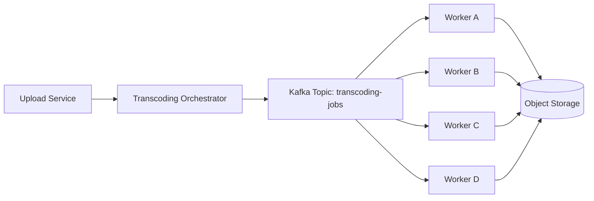
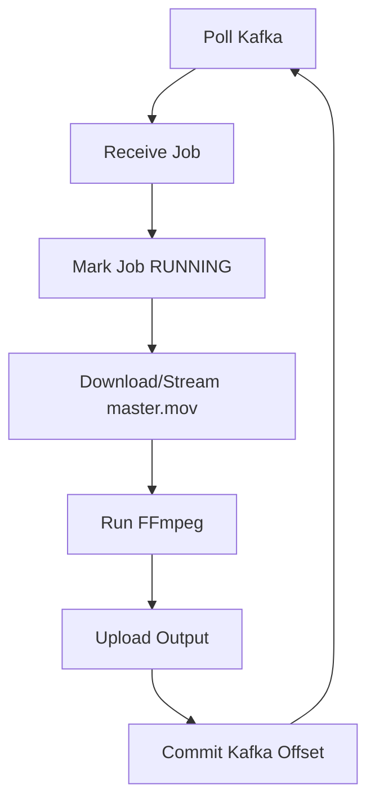
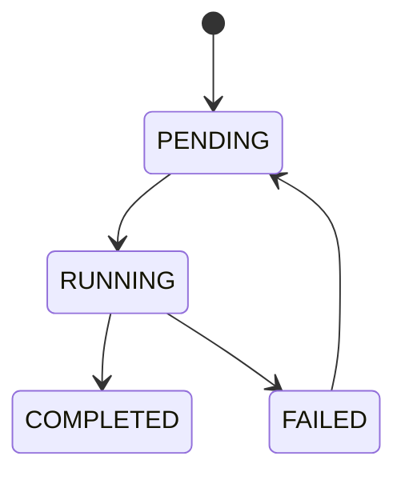

# Netflix System Design — Part 4: Transcoding Pipeline Internals

## Goal

Understand how Netflix converts one uploaded **master video (`master.mov`)** into multiple streaming-ready versions (240p, 360p, 480p, 720p, 1080p, 4K).

This chapter covers the **entire orchestration pipeline**:

- Who starts transcoding?
- How jobs are created.
- Why Kafka is used.
- How workers consume jobs.
- How failures and retries work.
- What happens before FFmpeg starts processing.

> **Scope:** We stop just before FFmpeg begins transcoding. FFmpeg internals are Part 5.

---

# Where We Left Off

After multipart upload completes, Object Storage contains one durable object.

```text
assets/
└── movie_8472/
    └── master.mov (200 GB)
```

The upload service marks the asset as:

```text
READY_FOR_PROCESSING
```

Users still **cannot stream** this movie because only one master asset exists.

---

# High-Level Architecture



---

# Step 1 — Upload Completion Triggers Transcoding

When `/uploads/complete` succeeds:

### Backend Flow

1. Multipart upload finishes.
2. `master.mov` is created in Object Storage.
3. Asset metadata is updated.
4. Upload service calls the **Transcoding Orchestrator**.

### Asset State

| Stage | Status |
|-------|--------|
| Uploading | `IN_PROGRESS` |
| Upload Finished | `READY_FOR_PROCESSING` |
| Jobs Created | `TRANSCODING` |

**Important**

The upload service **does not** start transcoding itself.

Its only responsibility is to notify the orchestrator.

---

# Step 2 — Transcoding Orchestrator

The orchestrator is a stateless backend service.

## Responsibilities

- Read uploaded asset metadata.
- Decide which renditions need to be generated.
- Create transcoding jobs.
- Publish jobs to Kafka.
- Update asset state.

It never processes video bytes.

---

# Step 3 — Decide Which Renditions to Generate

Suppose the uploaded movie is **4K HDR**.

Netflix creates one job for every required rendition.

| Rendition | Codec | Bitrate |
|-----------|-------|---------|
| 240p | H.264 | 300 kbps |
| 360p | H.264 | 700 kbps |
| 480p | H.264 | 1.2 Mbps |
| 720p | H.264 | 3 Mbps |
| 1080p | H.264 | 5 Mbps |
| 4K HDR | H.265 | 15–25 Mbps |

### Important

One uploaded movie becomes **multiple independent jobs**.

---

# Step 4 — Publish Jobs to Kafka

The orchestrator acts as a **Kafka Producer**.

## Topic

```text
Topic Name: transcoding-jobs
```

### Messages Published

```json
{
  "job_id": "job_240p",
  "asset_id": "movie_8472",
  "object_key": "assets/movie_8472/master.mov",
  "target_resolution": "240p",
  "codec": "H264",
  "bitrate": "300kbps"
}
```

Another message:

```json
{
  "job_id": "job_720p",
  "asset_id": "movie_8472",
  "object_key": "assets/movie_8472/master.mov",
  "target_resolution": "720p",
  "codec": "H264",
  "bitrate": "3Mbps"
}
```

### Kafka Topic After Publishing

```text
transcoding-jobs

Offset 0 → 240p Job
Offset 1 → 360p Job
Offset 2 → 480p Job
Offset 3 → 720p Job
Offset 4 → 1080p Job
Offset 5 → 4K HDR Job
```

Kafka stores these messages until workers consume them.

---

# Why Kafka Instead of Calling Workers Directly?

| Direct API Call | Kafka |
|-----------------|-------|
| Upload service waits for workers. | Upload service publishes and returns immediately. |
| Workers must already exist. | Workers consume whenever available. |
| Tight coupling. | Loose coupling. |
| Difficult retries. | Built-in retry through offsets. |
| Poor scalability. | Thousands of workers can consume jobs. |

**Intuition**

Kafka acts as a durable buffer between upload and transcoding.

---

# Step 5 — Kafka Partitions

Suppose Netflix has many uploaded movies.

```text
Topic: transcoding-jobs

Partition 0
Partition 1
Partition 2
Partition 3
```

### Example Distribution

```text
P0
Movie1-240p
Movie2-720p

P1
Movie1-360p
Movie3-1080p

P2
Movie1-480p
Movie4-4K

P3
Movie1-720p
Movie2-240p
```

### Why Partitions?

- Many workers can consume simultaneously.
- Jobs are distributed across machines.

**Partition Key**

Usually `job_id` (or another unique job identifier), so jobs are spread evenly across partitions.

---

# Step 6 — Consumer Group

All transcoding workers belong to one consumer group.

```text
Consumer Group

transcoding-workers
```

Workers:

```text
Worker A
Worker B
Worker C
Worker D
```

Kafka assigns partitions.

| Worker | Assigned Partitions |
|--------|----------------------|
| Worker A | Partition 0 |
| Worker B | Partition 1 |
| Worker C | Partition 2 |
| Worker D | Partition 3 |

Each message is processed by **exactly one worker** within the consumer group.

---

# Important Question — Does Every Quality Have Its Own Worker?

**No.**

Workers are **generic transcoding workers**.

Any worker can process any rendition.

### Example

| Worker | Job Picked |
|--------|------------|
| Worker A | Movie1 → 240p |
| Worker B | Movie1 → 360p |
| Worker C | Movie2 → 720p |
| Worker D | Movie1 → 4K |

Workers do **not** specialize in 240p or 720p.

The job message tells the worker what to produce.

### Why?

- Better load balancing.
- Easy horizontal scaling.
- Workers remain stateless.

---

# Step 7 — Worker Lifecycle

Every worker runs an infinite polling loop.



### Step-by-Step

1. Poll Kafka.
2. Receive one job.
3. Mark status as `RUNNING`.
4. Read input movie.
5. Transcode.
6. Upload result.
7. Commit Kafka offset.

Then poll for the next job.

---

# Step 8 — Job Status Tracking

Netflix stores job metadata separately.

## transcoding_jobs Table

| Column | Purpose |
|--------|---------|
| job_id | Unique transcoding job |
| asset_id | Movie being processed |
| rendition | 720p / 1080p / 4K |
| status | PENDING / RUNNING / COMPLETED / FAILED |
| worker_id | Worker processing it |
| retry_count | Retry attempts |
| output_key | Final storage location |

### State Machine



---

# Step 9 — What Happens If A Worker Crashes?

Example:

```text
Worker B receives 720p job.

Starts processing.

Machine crashes.
```

### Kafka Behavior

The worker never commits its offset.

Kafka still considers the message **unprocessed**.

After a timeout:

```text
Worker D receives the same job.
```

The job is executed again.

No manual retry is needed.

---

# Step 10 — Offset Commit (Very Important)

### Wrong Order ❌

```text
Receive Job
Commit Offset
Start FFmpeg
Crash
```

Job is permanently lost.

### Correct Order ✅

```text
Receive Job
Start FFmpeg
Upload Output
Commit Offset
```

Kafka offset is committed **only after successful upload**.

This guarantees **at-least-once processing**.

---

# Step 11 — Why Is Duplicate Processing Safe?

Suppose Worker B crashes after uploading output but before committing offset.

Worker D receives the same job.

Two workers may attempt the same rendition.

### Why Safe?

Every job has a unique `job_id`.

Workers write output to a deterministic path.

Example:

```text
assets/movie_8472/renditions/720p/video.mp4
```

The storage layer or job table ensures duplicate completion is ignored or safely overwritten.

This makes transcoding **idempotent**.

---

# Step 12 — What Happens After A Job Completes?

Worker uploads the generated rendition.

Example:

```text
assets/movie_8472/renditions/

240p/video.mp4
360p/video.mp4
480p/video.mp4
720p/video.mp4
1080p/video.mp4
4k/video.mp4
```

The worker updates the job table.

```text
Status = COMPLETED
```

The orchestrator waits until **all required rendition jobs** finish before moving the asset to the next pipeline stage.

---

# Failure Scenarios

| Scenario | Netflix Behavior |
|----------|------------------|
| Worker crashes before offset commit | Kafka redelivers the job. |
| Worker crashes after upload but before commit | Duplicate job runs safely (idempotent). |
| FFmpeg fails due to corrupt input | Job marked FAILED and retried. |
| Kafka unavailable temporarily | Orchestrator retries publishing jobs. |
| One rendition fails (720p) | Other renditions continue processing independently. |

---

# Key Takeaways

- The **Upload Service** only signals that `master.mov` is ready.
- A **Transcoding Orchestrator** creates one job for each required rendition.
- The orchestrator is a **Kafka producer** and publishes jobs to `transcoding-jobs`.
- Kafka partitions distribute jobs across many workers.
- Workers are **generic**; they can process any resolution based on the job message.
- Workers commit Kafka offsets **only after** the output rendition is successfully uploaded.
- Jobs are **idempotent**, so retries and duplicate deliveries are safe.
- After all rendition jobs complete, Netflix proceeds to the segmentation pipeline.

---

# Next Chapter

## Part 5 — FFmpeg Worker Internals

We'll answer:

- Does a worker download the full 200 GB movie?
- How does it stream bytes from Object Storage?
- How FFmpeg decodes, scales, and encodes video.
- CPU, memory, disk, and parallel processing inside a transcoding worker.