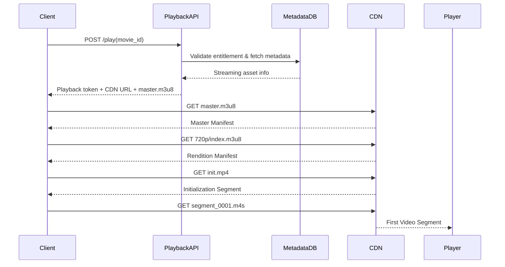
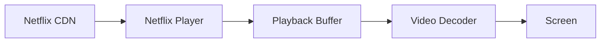
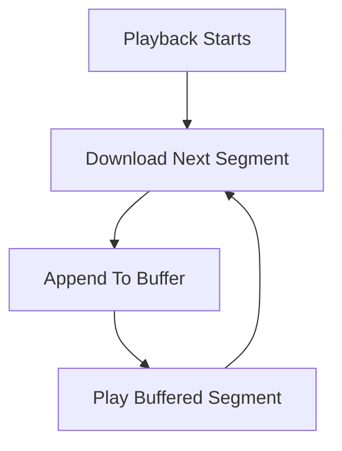

# Netflix System Design — Part 8: Play Video Pipeline Internals (User Clicks Play → First Frame)

## Goal

Understand the complete runtime flow when a user clicks **Play** on Netflix.

This chapter covers:

- Which backend APIs are called.
- How Netflix authorizes playback.
- How the player gets the manifest.
- How CDN is selected.
- How the first video segment is downloaded.
- How playback starts.

> **Scope:** First frame playback only. Adaptive bitrate switching, buffering strategy, and seeking will be covered in the next chapter.

---

### Transport Protocol

Video segments (`.m4s`, `init.mp4`, `.m3u8`) are downloaded over **HTTPS**.

- **Application protocol:** HTTP (HLS/DASH uses normal HTTP GET requests).
- **Transport protocol:** TCP for HTTP/1.1 and HTTP/2, or QUIC (UDP) when using HTTP/3.
- Each segment is fetched as a separate HTTPS GET request from the CDN.

# End-to-End Playback Flow



---

# Where We Left Off

CDN already contains streaming assets.

```text
movie_8472/

master.m3u8

720p/
    init.mp4
    index.m3u8
    segment_0001.m4s
    segment_0002.m4s

1080p/
    ...
```

Now the client starts playback.

---

# Step 1 — User Clicks Play

The Netflix app sends a request to the Playback Service.

## API

```http
POST /v1/play
```

## Request

```json
{
  "movie_id": "movie_8472",
  "device_id": "device_123",
  "profile_id": "profile_567"
}
```

### Why a Playback API?

The client should **not** know CDN paths directly.

The Playback Service decides what the client is allowed to stream.

---

# Step 2 — Playback Service Validates Playback

The Playback Service checks multiple things.

## Checks Performed

| Check | Purpose |
|-------|---------|
| User authentication | Is the user logged in? |
| Subscription entitlement | Can this user watch this title? |
| Device authorization | Is this device allowed? |
| Region availability | Is the movie available in this country? |

If validation fails:

```http
403 Forbidden
```

Otherwise playback continues.

---

# Step 3 — Fetch Streaming Metadata

The Playback Service reads metadata.

## Example Metadata

| Field | Value |
|-------|-------|
| asset_id | movie_8472 |
| manifest_path | assets/movie_8472/master.m3u8 |
| drm_required | true |
| available_audio | English, Hindi |
| available_subtitles | English, Hindi, Spanish |

Notice:

The Playback Service returns **manifest information**, not video segments.

---

# Step 4 — Select the Best CDN

Netflix chooses a CDN endpoint close to the user.

### Inputs

- User IP.
- Device location.
- Network provider.
- CDN health.

### Example Response

```json
{
  "cdn_base_url": "https://india-edge.netflix.com/movie_8472/",
  "manifest": "master.m3u8",
  "playback_token": "jwt_xyz"
}
```

### Why return a CDN URL?

Every future segment request goes directly to the CDN instead of Netflix application servers.

---

# Step 5 — Download Master Manifest

The client downloads:

```http
GET /movie_8472/master.m3u8
```

### Example Manifest

```text
240p/index.m3u8
360p/index.m3u8
480p/index.m3u8
720p/index.m3u8
1080p/index.m3u8
4k/index.m3u8
```

This tells the player **which qualities exist**.

---

# Step 6 — Player Chooses Initial Quality

The player picks an initial rendition.

### Inputs Used

| Signal | Example |
|--------|---------|
| Device screen | 1080p display |
| Current bandwidth | 12 Mbps |
| Startup strategy | Prefer fast startup |

### Example Choice

```text
720p/index.m3u8
```

Netflix usually starts conservatively rather than immediately choosing 4K.

---

# Step 7 — Download Rendition Manifest

```http
GET /720p/index.m3u8
```

### Example Rendition Manifest

```text
init.mp4

segment_0001.m4s
segment_0002.m4s
segment_0003.m4s
segment_0004.m4s
```

Now the player knows the order of segments.

---

# Step 8 — Download Initialization Segment

The player downloads `init.mp4`.

```http
GET /720p/init.mp4
```

### What Does `init.mp4` Contain?

It contains media initialization information.

- Codec information.
- Resolution.
- Track metadata.
- Decoder initialization data.

**Important**

It does **not** contain movie frames.

It is downloaded only once per rendition.

---

# Step 9 — Download First Video Segment

The player requests the first playable segment.

```http
GET /720p/segment_0001.m4s
```

The CDN returns approximately **2 seconds** of video.

```text
Segment Duration = 2 seconds

0s ───────────────► 2s
```

The player immediately appends this segment to its playback buffer.

---

# Step 10 — First Frame Appears

Playback starts after enough buffered data is available.

### Startup Buffer

Typical startup buffer:

```text
2–6 seconds
```

Example timeline:

| Time | Action |
|------|--------|
| 0 ms | User clicks Play. |
| 120 ms | Playback API responds. |
| 250 ms | Manifest downloaded. |
| 450 ms | init.mp4 downloaded. |
| 700 ms | First segment downloaded. |
| ~800–1000 ms | First frame displayed. |

---

# Why Doesn't Playback Wait For The Whole Movie?

Because playback is segment-based.

```text
Movie Length = 2 hours

Player downloads

Segment 1
Segment 2
Segment 3
...
```

Only a few seconds are buffered ahead.

This minimizes startup latency.

---

# Objects Downloaded During Startup

| File | Downloaded When |
|------|-----------------|
| `master.m3u8` | Once |
| `720p/index.m3u8` | Once |
| `720p/init.mp4` | Once |
| `segment_0001.m4s` | Immediately |
| `segment_0002.m4s` | While playing Segment 1 |
| `segment_0003.m4s` | Background download |

---

# Failure Scenarios

| Scenario | Netflix Behavior |
|----------|------------------|
| Playback API fails | Retry API request. |
| Manifest unavailable | Playback cannot start. |
| CDN edge unavailable | Switch to another healthy CDN endpoint. |
| First segment fails | Retry or switch CDN before showing an error. |

---

# Key Takeaways

- The client first contacts **Playback Service**, not the CDN.
- Playback Service performs authentication, entitlement, region, and device checks.
- The response contains a **CDN URL + playback token + master manifest location**.
- The player downloads `master.m3u8`, selects an initial quality, downloads `index.m3u8`, then `init.mp4`.
- Playback starts after the first few video segments are buffered.
- All video bytes after the playback API come directly from the CDN, not Netflix backend servers.

---


# Netflix System Design — Part 9: Netflix Player Internals (Adaptive Bitrate, Buffering & Seeking)

## Goal

Understand what happens **inside the Netflix player** after the first frame starts playing.

This chapter covers:

- How the player chooses video quality.
- How adaptive bitrate (ABR) switching works.
- How buffering works.
- How seeking works.
- How segment downloads happen continuously.

> **Scope:** Client-side playback logic only.

---

# High-Level Player Architecture



The player continuously downloads segments while simultaneously playing previously downloaded segments.

---

# Step 1 — Player Maintains a Playback Buffer

The player never plays directly from the network.

Instead it stores downloaded segments in memory.

## Example

```text
Playback Timeline

Playing → Segment 10

Buffer

Segment 11
Segment 12
Segment 13
```

### Important

Playback consumes Segment 10 while Segments 11–13 are downloading.

---

# How Much Does Netflix Buffer?

Typical values (conceptual):

| Situation | Buffer Ahead |
|-----------|--------------|
| Startup | 2–6 seconds |
| Stable Playback | 20–60 seconds |
| Slow Network | Smaller buffer |

The player continuously adjusts buffer size.

---

# Step 2 — Download Loop

The player runs a continuous download loop.



Example:

```text
Play Segment 10

Download Segment 11
Download Segment 12

Play Segment 11

Download Segment 13
```

Downloads and playback happen simultaneously.

---

# Step 3 — Adaptive Bitrate (ABR)

The player measures current network bandwidth.

### Inputs Used

| Signal | Example |
|--------|---------|
| Segment download speed | 18 Mbps |
| Buffer health | 30 seconds buffered |
| Device resolution | 1080p display |
| CPU capability | Can decode 1080p? |

The player selects the highest safe quality.

---

# Example ABR Decision

| Network Speed | Player Chooses |
|--------------|----------------|
| 0.8 Mbps | 240p |
| 2 Mbps | 480p |
| 5 Mbps | 720p |
| 10 Mbps | 1080p |
| 25 Mbps | 4K |

The player changes quality dynamically.

---

# Step 4 — How Bandwidth Is Estimated

The player measures every segment download.

### Example

```text
Segment Size = 1 MB

Downloaded In = 0.5 seconds

Estimated Bandwidth = 16 Mbps
```

It continuously updates this estimate after every segment.

---

# Step 5 — Switching Quality

Suppose playback starts at 720p.

Buffer currently contains:

```text
720p

Segment 11
Segment 12
Segment 13
```

Network becomes faster.

Player downloads future segments from 1080p.

```text
720p

Segment 11
Segment 12

1080p

Segment 13
Segment 14
Segment 15
```

### Important

Already buffered segments remain 720p.

Only future segments switch quality.

This makes switching seamless.

---

# Step 6 — Why Switching Is Smooth

All renditions were segmented using the same timeline.

```text
240p

Segment 15 → 28s–30s

720p

Segment 15 → 28s–30s

1080p

Segment 15 → 28s–30s
```

Segment numbers represent the **same playback time** across all qualities.

The player simply changes the URL.

Example:

```text
Before

720p/segment_0015.m4s

After

1080p/segment_0015.m4s
```

Playback continues without restarting.

---

# Step 7 — Buffer Underflow

Suppose the network becomes slow.

Buffer shrinks.

```text
Playing Segment 20

Buffer

Segment 21
```

If Segment 22 isn't downloaded in time:

```text
Buffer Empty
```

Playback pauses.

The player shows buffering.

---

# Step 8 — Recovery From Buffering

The player reduces quality.

Example:

```text
720p → 480p
```

Smaller segments download faster.

Buffer fills again.

Playback resumes.

---

# Step 9 — Seeking

User jumps to **1 hour 23 minutes**.

### Step 1

Player converts timestamp to segment number.

Example:

```text
Segment Duration = 2 seconds

1:23:00

4980 seconds

4980 / 2 = Segment 2490
```

### Step 2

Request new segment.

```http
GET /720p/segment_2490.m4s
```

### Step 3

Discard old buffer.

### Step 4

Start buffering from Segment 2490 onward.

Seeking is just downloading a different segment.

---

# Step 10 — Fast Forward / Rewind

Example:

```text
Jump +30 seconds

Current Segment = 120

New Segment = 135
```

Player starts requesting segments from 135.

No previous segments are downloaded again.

---

# Step 11 — Segment Retry Strategy

If a segment download fails:

### Retry Order

1. Retry same CDN edge.
2. Retry another CDN edge.
3. Drop quality.
4. Pause playback if retries fail.

This happens per segment.

---

# Step 12 — Playback Events

The player continuously emits events.

| Event | Purpose |
|-------|---------|
| Playback Started | Analytics |
| Segment Downloaded | QoE metrics |
| Buffering Started | Quality monitoring |
| Buffering Ended | QoE metrics |
| Seeked | Playback state |
| Playback Progress | Continue Watching |

These events are sent asynchronously and never block playback.

---

# Complete Runtime Timeline

```text
Play Click

Download master.m3u8
Download index.m3u8
Download init.mp4

Download Segment 1
Download Segment 2

Playback Starts

Download Segment 3
Download Segment 4
...

Network Slow

Switch 720p → 480p

Continue Playback

User Seeks

Download Segment 2490

Continue Playback
```

---

# Failure Scenarios

| Scenario | Player Behavior |
|----------|-----------------|
| Slow network | Switch to lower bitrate. |
| CDN timeout | Retry another CDN endpoint. |
| Segment download fails | Retry segment before buffering. |
| Buffer empty | Pause playback until buffer refills. |
| User changes quality manually | Future segments use selected quality. |

---

# Key Takeaways

- The player always plays from a **buffer**, never directly from the network.
- It continuously downloads upcoming segments while playing buffered ones.
- ABR decisions are made after measuring bandwidth and buffer health.
- Quality switches happen **only for future segments**.
- Seeking simply maps a timestamp to a segment number and starts downloading from there.
- Playback events are emitted asynchronously for analytics and resume playback.

---

# Next Chapter

## Part 10 — Continue Watching & Playback Progress Pipeline

We'll build the backend pipeline for:

- Saving playback position.
- Resume playback across devices.
- Kafka events.
- Redis + Database.
- Exactly-once progress updates.