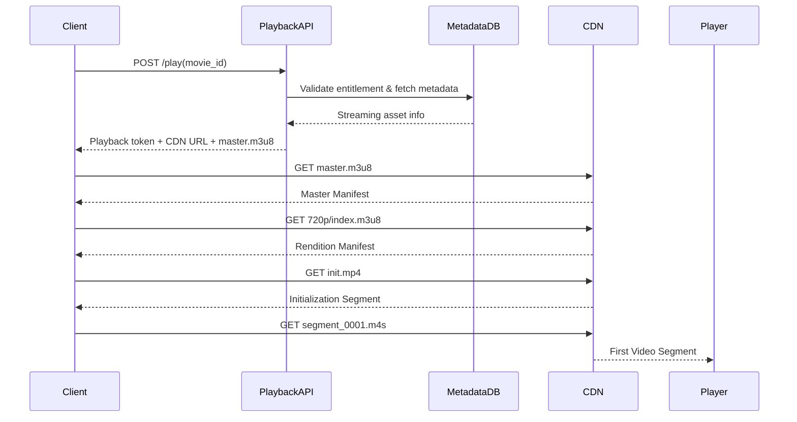

# Netflix System Design — Part 8: Play Video Pipeline Internals (User Clicks Play → First Frame)

## Goal

Understand the complete runtime flow when a user clicks **Play** on Netflix.

This chapter covers:

- Which backend APIs are called.
- How Netflix authorizes playback.
- How the player gets the manifest.
- How CDN is selected.
- How the first video segment is downloaded.
- How playback starts.

> **Scope:** First frame playback only. Adaptive bitrate switching, buffering strategy, and seeking will be covered in the next chapter.

---

# End-to-End Playback Flow



---

# Where We Left Off

CDN already contains streaming assets.

```text
movie_8472/

master.m3u8

720p/
    init.mp4
    index.m3u8
    segment_0001.m4s
    segment_0002.m4s

1080p/
    ...
```

Now the client starts playback.

---

# Step 1 — User Clicks Play

The Netflix app sends a request to the Playback Service.

## API

```http
POST /v1/play
```

## Request

```json
{
  "movie_id": "movie_8472",
  "device_id": "device_123",
  "profile_id": "profile_567"
}
```

### Why a Playback API?

The client should **not** know CDN paths directly.

The Playback Service decides what the client is allowed to stream.

---

# Step 2 — Playback Service Validates Playback

The Playback Service checks multiple things.

## Checks Performed

| Check | Purpose |
|-------|---------|
| User authentication | Is the user logged in? |
| Subscription entitlement | Can this user watch this title? |
| Device authorization | Is this device allowed? |
| Region availability | Is the movie available in this country? |

If validation fails:

```http
403 Forbidden
```

Otherwise playback continues.

---

# Step 3 — Fetch Streaming Metadata

The Playback Service reads metadata.

## Example Metadata

| Field | Value |
|-------|-------|
| asset_id | movie_8472 |
| manifest_path | assets/movie_8472/master.m3u8 |
| drm_required | true |
| available_audio | English, Hindi |
| available_subtitles | English, Hindi, Spanish |

Notice:

The Playback Service returns **manifest information**, not video segments.

---

# Step 4 — Select the Best CDN

Netflix chooses a CDN endpoint close to the user.

### Inputs

- User IP.
- Device location.
- Network provider.
- CDN health.

### Example Response

```json
{
  "cdn_base_url": "https://india-edge.netflix.com/movie_8472/",
  "manifest": "master.m3u8",
  "playback_token": "jwt_xyz"
}
```

### Why return a CDN URL?

Every future segment request goes directly to the CDN instead of Netflix application servers.

---

# Step 5 — Download Master Manifest

The client downloads:

```http
GET /movie_8472/master.m3u8
```

### Example Manifest

```text
240p/index.m3u8
360p/index.m3u8
480p/index.m3u8
720p/index.m3u8
1080p/index.m3u8
4k/index.m3u8
```

This tells the player **which qualities exist**.

---

# Step 6 — Player Chooses Initial Quality

The player picks an initial rendition.

### Inputs Used

| Signal | Example |
|--------|---------|
| Device screen | 1080p display |
| Current bandwidth | 12 Mbps |
| Startup strategy | Prefer fast startup |

### Example Choice

```text
720p/index.m3u8
```

Netflix usually starts conservatively rather than immediately choosing 4K.

---

# Step 7 — Download Rendition Manifest

```http
GET /720p/index.m3u8
```

### Example Rendition Manifest

```text
init.mp4

segment_0001.m4s
segment_0002.m4s
segment_0003.m4s
segment_0004.m4s
```

Now the player knows the order of segments.

---

# Step 8 — Download Initialization Segment

The player downloads `init.mp4`.

```http
GET /720p/init.mp4
```

### What Does `init.mp4` Contain?

It contains media initialization information.

- Codec information.
- Resolution.
- Track metadata.
- Decoder initialization data.

**Important**

It does **not** contain movie frames.

It is downloaded only once per rendition.

---

# Step 9 — Download First Video Segment

The player requests the first playable segment.

```http
GET /720p/segment_0001.m4s
```

The CDN returns approximately **2 seconds** of video.

```text
Segment Duration = 2 seconds

0s ───────────────► 2s
```

The player immediately appends this segment to its playback buffer.

---

# Step 10 — First Frame Appears

Playback starts after enough buffered data is available.

### Startup Buffer

Typical startup buffer:

```text
2–6 seconds
```

Example timeline:

| Time | Action |
|------|--------|
| 0 ms | User clicks Play. |
| 120 ms | Playback API responds. |
| 250 ms | Manifest downloaded. |
| 450 ms | init.mp4 downloaded. |
| 700 ms | First segment downloaded. |
| ~800–1000 ms | First frame displayed. |

---

# Why Doesn't Playback Wait For The Whole Movie?

Because playback is segment-based.

```text
Movie Length = 2 hours

Player downloads

Segment 1
Segment 2
Segment 3
...
```

Only a few seconds are buffered ahead.

This minimizes startup latency.

---

# Objects Downloaded During Startup

| File | Downloaded When |
|------|-----------------|
| `master.m3u8` | Once |
| `720p/index.m3u8` | Once |
| `720p/init.mp4` | Once |
| `segment_0001.m4s` | Immediately |
| `segment_0002.m4s` | While playing Segment 1 |
| `segment_0003.m4s` | Background download |

---

# Failure Scenarios

| Scenario | Netflix Behavior |
|----------|------------------|
| Playback API fails | Retry API request. |
| Manifest unavailable | Playback cannot start. |
| CDN edge unavailable | Switch to another healthy CDN endpoint. |
| First segment fails | Retry or switch CDN before showing an error. |

---

# Key Takeaways

- The client first contacts **Playback Service**, not the CDN.
- Playback Service performs authentication, entitlement, region, and device checks.
- The response contains a **CDN URL + playback token + master manifest location**.
- The player downloads `master.m3u8`, selects an initial quality, downloads `index.m3u8`, then `init.mp4`.
- Playback starts after the first few video segments are buffered.
- All video bytes after the playback API come directly from the CDN, not Netflix backend servers.

---

# Next Chapter

## Part 9 — Netflix Player Internals (Adaptive Bitrate, Buffering, Seeking)

We'll deep dive into:

- How the player measures bandwidth.
- When it switches from 720p to 1080p.
- Buffer management.
- Seeking to 1 hour 23 minutes.
- Parallel segment downloads and retry strategy.