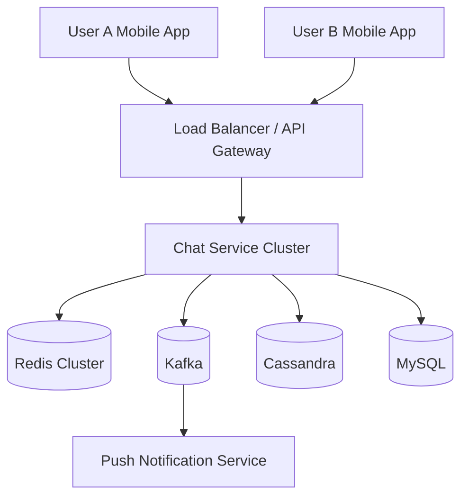

# WhatsApp System Design — Foundation & Architecture

> Building WhatsApp from Scratch → Production Scale (Meta-style Architecture)

---

# Table of Contents

1. Introduction
2. What We Are Building
3. Functional Requirements
4. Non-Functional Requirements
5. Capacity Estimation
6. Core Design Principles
7. High-Level Architecture Overview
8. Components of WhatsApp
9. Request Flow Overview
10. Summary

---

# 1. Introduction

This series explains how WhatsApp can be built from a single backend server into a globally distributed messaging platform capable of serving **billions of users**.

The goal is **not** to memorize an interview diagram.

Instead, we will understand every engineering decision:

- Why WebSockets instead of HTTP Polling?
- Why Cassandra stores messages?
- Why Redis stores sessions?
- Why Kafka sits between services?
- How message ordering works.
- How offline messages are delivered.
- How end-to-end encryption works.
- How WhatsApp scales to billions of messages every day.

By the end of this series, you'll understand the complete backend architecture behind modern chat applications.

---

# 2. What Are We Building?

WhatsApp is a **real-time messaging platform**.

It allows users to:

- Register using a phone number.
- Discover contacts.
- Send text messages instantly.
- Send media files.
- Create groups.
- Receive notifications while offline.
- See typing indicators.
- See delivered/read receipts.
- Make voice/video calls.

A simplified product contains three major domains:

| Domain | Responsibility |
|--------|----------------|
| Identity | Users, authentication, contacts |
| Messaging | Chats, messages, delivery |
| Communication | Calls, notifications, presence |

---

# 3. Functional Requirements

## 3.1 User Features

Users should be able to:

- Register.
- Login.
- Verify phone number using OTP.
- Update profile.
- Upload profile picture.
- Sync contacts.

---

## 3.2 Messaging Features

- One-to-one chat.
- Group chat.
- Text messages.
- Emoji.
- Stickers.
- Voice notes.
- Images.
- Videos.
- Documents.
- Reply to messages.
- Forward messages.

---

## 3.3 Real-Time Features

- Online status.
- Typing indicator.
- Delivered receipt.
- Read receipt.
- Last seen.

---

## 3.4 Notifications

- Push notification.
- Silent notification.
- Badge count.

---

## 3.5 Multi Device

- Mobile.
- Desktop.
- Web.

A user may be logged in from multiple devices simultaneously.

---

# 4. Non Functional Requirements

These requirements make WhatsApp challenging.

## 4.1 Availability

Users expect messages anytime.

Target:

- 99.99% uptime.
- No single point of failure.

---

## 4.2 Low Latency

Messages should appear almost instantly.

Target latency:

| Operation | Latency |
|-----------|----------|
| Send Message | 100-300 ms |
| Typing Indicator | Under 100 ms |
| Read Receipt | Under 200 ms |

---

## 4.3 Reliability

Messages should never disappear.

Requirements:

- Durable storage.
- Retry on failures.
- Duplicate prevention.
- Ordering guarantee.

---

## 4.4 Scalability

System should support:

- Billions of users.
- Millions of concurrent WebSocket connections.
- Millions of messages per second.

---

## 4.5 Security

Everything must be secure.

- Authentication.
- Authorization.
- Encryption in transit.
- End-to-end encryption.
- Secure media URLs.

---

# 5. Capacity Estimation

Before designing architecture, estimate the scale.

---

## 5.1 Monthly Active Users

Assume:

- 3 Billion users.
- 2 Billion daily active users.

---

## 5.2 Concurrent Users

Assume:

30% online simultaneously.

2 Billion × 30%

= 600 Million concurrent connections.

This immediately tells us:

**One server cannot handle this.**

---

## 5.3 Messages Per Day

Assume:

150 Billion messages/day.

Messages/second:

150B / 86400

≈ 1.7 Million messages/sec.

Peak traffic may reach:

5–10 Million messages/sec.

---

## 5.4 Media Uploads

Assume:

- 2 Billion images/day.
- 500 Million videos/day.
- 1 Billion voice notes/day.

Media storage grows much faster than text storage.

---

## 5.5 Storage Estimation

Average text message:

300 Bytes.

150B × 300 Bytes

≈ 45 TB/day.

Media may consume multiple petabytes daily.

---

# Why Capacity Estimation Matters

Capacity estimation decides:

| Question | Impact |
|----------|--------|
| Database choice | Cassandra vs MySQL |
| Cache size | Redis Cluster |
| Queue throughput | Kafka partitions |
| Storage | Object Storage |
| Network bandwidth | CDN |

---

# 6. Core Design Principles

Throughout this series we follow these principles.

## Principle 1 — Stateless Services

API servers should not store user state locally.

Why?

Because requests may hit any server.

State lives in Redis/Database.

---

## Principle 2 — Persistent Connections

Instead of creating an HTTP request for every message...

Maintain one TCP/WebSocket connection.

Benefits:

- Lower latency.
- Less handshake overhead.
- Real-time delivery.

---

## Principle 3 — Event Driven Architecture

Sending a message should publish an event.

Consumers independently handle:

- Delivery.
- Notifications.
- Analytics.
- Backup.
- Read receipts.

Kafka enables loose coupling.

---

## Principle 4 — Horizontal Scaling

Instead of bigger machines...

Add more servers.

Load balancer distributes traffic.

---

## Principle 5 — Durable Messaging

A message is considered safe only after durable storage.

Never depend only on memory.

---

# 7. High Level Architecture

## Big Picture



---

# Understanding This Architecture

## Client

Responsible for:

- UI.
- Encryption.
- Local cache.
- WebSocket connection.

---

## Load Balancer

Responsibilities:

- TLS termination.
- Routing.
- Rate limiting.
- Sticky routing if required.

---

## Chat Service

Core backend.

Handles:

- Authentication.
- WebSocket sessions.
- Message validation.
- Delivery pipeline.

---

## Redis

Stores hot data.

Examples:

- User session.
- Online status.
- Device mapping.
- Presence cache.

Redis is **not** permanent storage.

---

## Cassandra

Stores messages.

Reasons:

- Massive write throughput.
- Horizontal scalability.
- Replication.
- Time-series friendly.

We'll study this later.

---

## MySQL

Stores relational metadata.

Examples:

- Users.
- Contacts.
- Group metadata.
- Devices.

---

## Kafka

Acts as event bus.

Message published once.

Many consumers process independently.

---

## Push Service

Sends notification if recipient is offline.

Examples:

- FCM.
- APNs.

---

# 8. Components of WhatsApp

## 8.1 Client Application

Stores locally:

- Messages.
- Media cache.
- Encryption keys.
- Pending outgoing messages.

Responsibilities:

- Retry unsent messages.
- Render conversations.
- Maintain socket.

---

## 8.2 Authentication Service

Responsible for:

- OTP generation.
- OTP verification.
- Device registration.
- Access token generation.

Will be discussed in detail later.

---

## 8.3 User Service

Stores:

- Name.
- Phone number.
- Profile photo.
- Privacy settings.

---

## 8.4 Contact Service

Uploads hashed contacts.

Returns WhatsApp users among contacts.

Privacy preserving.

---

## 8.5 Chat Service

The heart of messaging.

Responsibilities:

- Accept messages.
- Assign message ID.
- Persist message.
- Deliver message.
- Retry.
- Generate receipts.

---

## 8.6 Presence Service

Tracks:

- Online.
- Offline.
- Last seen.
- Typing.
- Recording voice.

Presence data changes frequently.

Redis is ideal.

---

## 8.7 Notification Service

If recipient disconnected:

Publish push notification.

Does not send message content unless privacy allows.

---

# 9. End-to-End Request Flow (Without WebSockets Yet)

Initially imagine WhatsApp built using HTTP.

## Step-by-Step

```text
User A
   |
HTTP POST /sendMessage
   |
API Gateway
   |
Chat Service
   |
Store Message
   |
Database
   |
Look up recipient
   |
Recipient online?
   |------No------> Push Notification
   |
  Yes
   |
HTTP callback / polling response
   |
Recipient receives message
```

This works...

But has problems.

---

# Problems with HTTP Messaging

## Problem 1

Every message creates a new TCP connection.

Expensive.

---

## Problem 2

Recipient has to poll.

Example:

Every second:

GET /messages

Huge waste.

---

## Problem 3

Typing indicator impossible without excessive polling.

---

## Problem 4

Battery drain.

Millions of polling requests.

---

# Why WhatsApp Uses Persistent Connections

Instead of:

- Request.
- Response.
- Disconnect.

WhatsApp creates one connection.

```text
Phone
   |
WebSocket
   |
Chat Server

Message 1
Message 2
Typing...
Read receipt...
Heartbeat...
```

Connection remains alive for hours.

We'll build this architecture in the next MD.

---

# 10. Design Decisions Introduced So Far

| Requirement | Component |
|-------------|-----------|
| Identity | MySQL |
| Sessions | Redis |
| Messages | Cassandra |
| Events | Kafka |
| Notifications | Push Service |
| Real-time delivery | WebSocket |

---

# Production Notes

### Why not store messages in MySQL?

- Very high write volume.
- Time-series access pattern.
- Horizontal scaling becomes difficult.

Cassandra is optimized for append-heavy workloads.

---

### Why Redis instead of Database for online users?

Presence changes every few seconds.

Writing every heartbeat into MySQL would overwhelm the database.

Redis supports in-memory updates with TTL.

---

### Why Kafka between services?

Without Kafka:

Chat Service directly calls Notification Service.

Services become tightly coupled.

Kafka allows asynchronous processing.

---

# Interview Notes

Common questions after this chapter:

1. Why WebSockets instead of HTTP Polling?
2. Why Cassandra for chat messages?
3. Why Redis for presence?
4. Why Kafka in messaging architecture?
5. What happens when recipient is offline?

These will all be answered in upcoming chapters.

---

# Summary

In this chapter we built the foundation of WhatsApp.

We identified:

- Functional requirements.
- Non-functional requirements.
- Scale of billions of users.
- Major backend components.
- Initial architecture.
- Why persistent connections are necessary.

The next chapter builds the **entire one-to-one messaging pipeline**, including WebSockets, ACKs, ordering, retries, offline delivery, duplicate prevention, Redis sessions, Kafka topics, Cassandra writes, and message lifecycle.