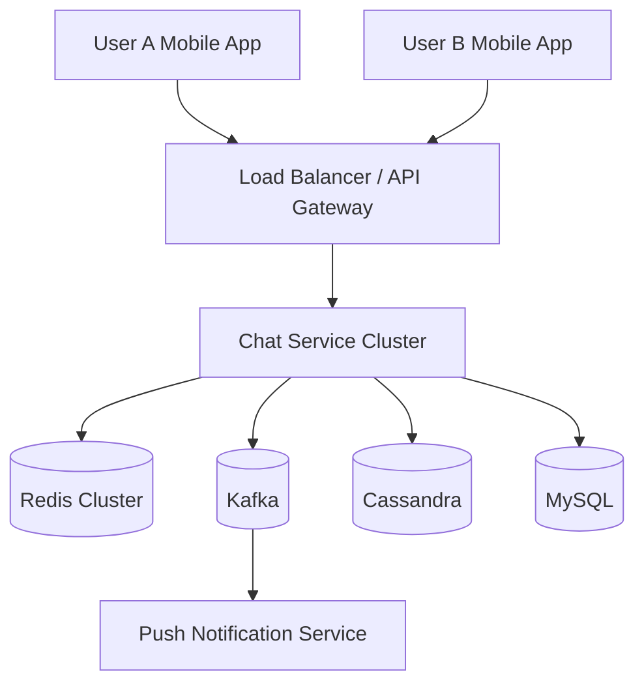
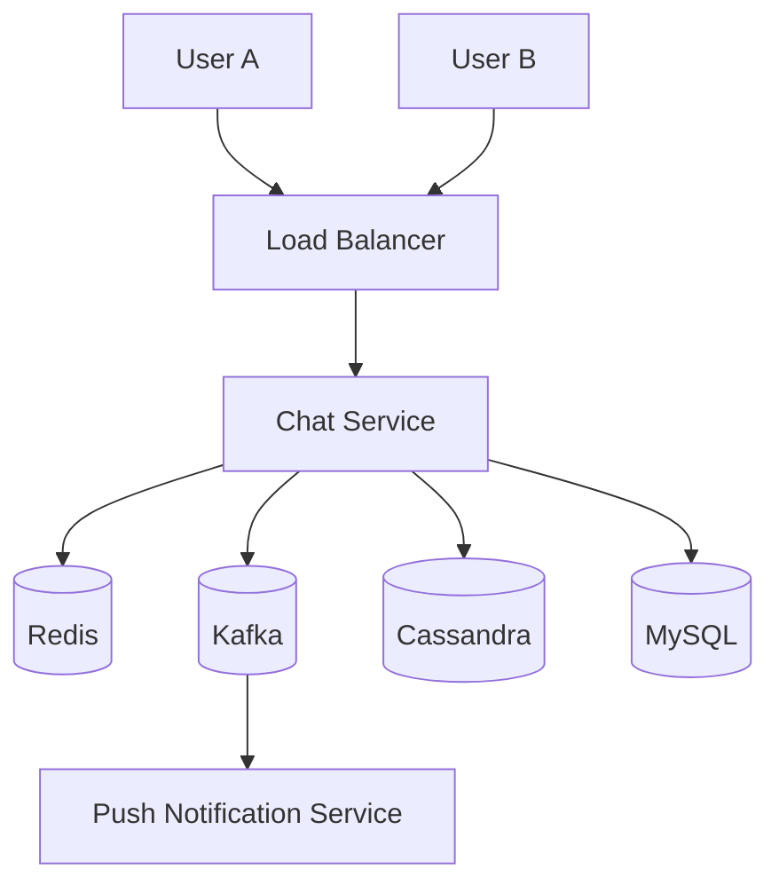

# WhatsApp System Design — Foundation & Architecture

> Building WhatsApp from Scratch → Production Scale (Meta-style Architecture)

---

# Table of Contents

1. Introduction
2. What We Are Building
3. Functional Requirements
4. Non-Functional Requirements
5. Capacity Estimation
6. Core Design Principles
7. High-Level Architecture Overview
8. Components of WhatsApp
9. Request Flow Overview
10. Summary

---

# 1. Introduction

This series explains how WhatsApp can be built from a single backend server into a globally distributed messaging platform capable of serving **billions of users**.

The goal is **not** to memorize an interview diagram.

Instead, we will understand every engineering decision:

- Why WebSockets instead of HTTP Polling?
- Why Cassandra stores messages?
- Why Redis stores sessions?
- Why Kafka sits between services?
- How message ordering works.
- How offline messages are delivered.
- How end-to-end encryption works.
- How WhatsApp scales to billions of messages every day.

By the end of this series, you'll understand the complete backend architecture behind modern chat applications.

---

# 2. What Are We Building?

WhatsApp is a **real-time messaging platform**.

It allows users to:

- Register using a phone number.
- Discover contacts.
- Send text messages instantly.
- Send media files.
- Create groups.
- Receive notifications while offline.
- See typing indicators.
- See delivered/read receipts.
- Make voice/video calls.

A simplified product contains three major domains:

| Domain | Responsibility |
|--------|----------------|
| Identity | Users, authentication, contacts |
| Messaging | Chats, messages, delivery |
| Communication | Calls, notifications, presence |

---

# 3. Functional Requirements

## 3.1 User Features

Users should be able to:

- Register.
- Login.
- Verify phone number using OTP.
- Update profile.
- Upload profile picture.
- Sync contacts.

---

## 3.2 Messaging Features

- One-to-one chat.
- Group chat.
- Text messages.
- Emoji.
- Stickers.
- Voice notes.
- Images.
- Videos.
- Documents.
- Reply to messages.
- Forward messages.

---

## 3.3 Real-Time Features

- Online status.
- Typing indicator.
- Delivered receipt.
- Read receipt.
- Last seen.

---

## 3.4 Notifications

- Push notification.
- Silent notification.
- Badge count.

---

## 3.5 Multi Device

- Mobile.
- Desktop.
- Web.

A user may be logged in from multiple devices simultaneously.

---

# 4. Non Functional Requirements

These requirements make WhatsApp challenging.

## 4.1 Availability

Users expect messages anytime.

Target:

- 99.99% uptime.
- No single point of failure.

---

## 4.2 Low Latency

Messages should appear almost instantly.

Target latency:

| Operation | Latency |
|-----------|----------|
| Send Message | 100-300 ms |
| Typing Indicator | Under 100 ms |
| Read Receipt | Under 200 ms |

---

## 4.3 Reliability

Messages should never disappear.

Requirements:

- Durable storage.
- Retry on failures.
- Duplicate prevention.
- Ordering guarantee.

---

## 4.4 Scalability

System should support:

- Billions of users.
- Millions of concurrent WebSocket connections.
- Millions of messages per second.

---

## 4.5 Security

Everything must be secure.

- Authentication.
- Authorization.
- Encryption in transit.
- End-to-end encryption.
- Secure media URLs.

---

# 5. Capacity Estimation

Before designing architecture, estimate the scale.

---

## 5.1 Monthly Active Users

Assume:

- 3 Billion users.
- 2 Billion daily active users.

---

## 5.2 Concurrent Users

Assume:

30% online simultaneously.

2 Billion × 30%

= 600 Million concurrent connections.

This immediately tells us:

**One server cannot handle this.**

---

## 5.3 Messages Per Day

Assume:

150 Billion messages/day.

Messages/second:

150B / 86400

≈ 1.7 Million messages/sec.

Peak traffic may reach:

5–10 Million messages/sec.

---

## 5.4 Media Uploads

Assume:

- 2 Billion images/day.
- 500 Million videos/day.
- 1 Billion voice notes/day.

Media storage grows much faster than text storage.

---

## 5.5 Storage Estimation

Average text message:

300 Bytes.

150B × 300 Bytes

≈ 45 TB/day.

Media may consume multiple petabytes daily.

---

# Why Capacity Estimation Matters

Capacity estimation decides:

| Question | Impact |
|----------|--------|
| Database choice | Cassandra vs MySQL |
| Cache size | Redis Cluster |
| Queue throughput | Kafka partitions |
| Storage | Object Storage |
| Network bandwidth | CDN |

---

# 6. Core Design Principles

Throughout this series we follow these principles.

## Principle 1 — Stateless Services

API servers should not store user state locally.

Why?

Because requests may hit any server.

State lives in Redis/Database.

---

## Principle 2 — Persistent Connections

Instead of creating an HTTP request for every message...

Maintain one TCP/WebSocket connection.

Benefits:

- Lower latency.
- Less handshake overhead.
- Real-time delivery.

---

## Principle 3 — Event Driven Architecture

Sending a message should publish an event.

Consumers independently handle:

- Delivery.
- Notifications.
- Analytics.
- Backup.
- Read receipts.

Kafka enables loose coupling.

---

## Principle 4 — Horizontal Scaling

Instead of bigger machines...

Add more servers.

Load balancer distributes traffic.

---

## Principle 5 — Durable Messaging

A message is considered safe only after durable storage.

Never depend only on memory.

---

# 7. High Level Architecture

## Big Picture



---

# Understanding This Architecture

## Client

Responsible for:

- UI.
- Encryption.
- Local cache.
- WebSocket connection.

---

## Load Balancer

Responsibilities:

- TLS termination.
- Routing.
- Rate limiting.
- Sticky routing if required.

---

## Chat Service

Core backend.

Handles:

- Authentication.
- WebSocket sessions.
- Message validation.
- Delivery pipeline.

---

## Redis

Stores hot data.

Examples:

- User session.
- Online status.
- Device mapping.
- Presence cache.

Redis is **not** permanent storage.

---

## Cassandra

Stores messages.

Reasons:

- Massive write throughput.
- Horizontal scalability.
- Replication.
- Time-series friendly.

We'll study this later.

---

## MySQL

Stores relational metadata.

Examples:

- Users.
- Contacts.
- Group metadata.
- Devices.

---

## Kafka

Acts as event bus.

Message published once.

Many consumers process independently.

---

## Push Service

Sends notification if recipient is offline.

Examples:

- FCM.
- APNs.

---

# 8. Components of WhatsApp

## 8.1 Client Application

Stores locally:

- Messages.
- Media cache.
- Encryption keys.
- Pending outgoing messages.

Responsibilities:

- Retry unsent messages.
- Render conversations.
- Maintain socket.

---

## 8.2 Authentication Service

Responsible for:

- OTP generation.
- OTP verification.
- Device registration.
- Access token generation.

Will be discussed in detail later.

---

## 8.3 User Service

Stores:

- Name.
- Phone number.
- Profile photo.
- Privacy settings.

---

## 8.4 Contact Service

Uploads hashed contacts.

Returns WhatsApp users among contacts.

Privacy preserving.

---

## 8.5 Chat Service

The heart of messaging.

Responsibilities:

- Accept messages.
- Assign message ID.
- Persist message.
- Deliver message.
- Retry.
- Generate receipts.

---

## 8.6 Presence Service

Tracks:

- Online.
- Offline.
- Last seen.
- Typing.
- Recording voice.

Presence data changes frequently.

Redis is ideal.

---

## 8.7 Notification Service

If recipient disconnected:

Publish push notification.

Does not send message content unless privacy allows.

---

# 9. End-to-End Request Flow (Without WebSockets Yet)

Initially imagine WhatsApp built using HTTP.

## Step-by-Step

```text
User A
   |
HTTP POST /sendMessage
   |
API Gateway
   |
Chat Service
   |
Store Message
   |
Database
   |
Look up recipient
   |
Recipient online?
   |------No------> Push Notification
   |
  Yes
   |
HTTP callback / polling response
   |
Recipient receives message
```

This works...

But has problems.

---

# Problems with HTTP Messaging

## Problem 1

Every message creates a new TCP connection.

Expensive.

---

## Problem 2

Recipient has to poll.

Example:

Every second:

GET /messages

Huge waste.

---

## Problem 3

Typing indicator impossible without excessive polling.

---

## Problem 4

Battery drain.

Millions of polling requests.

---

# Why WhatsApp Uses Persistent Connections

Instead of:

- Request.
- Response.
- Disconnect.

WhatsApp creates one connection.

```text
Phone
   |
WebSocket
   |
Chat Server

Message 1
Message 2
Typing...
Read receipt...
Heartbeat...
```

Connection remains alive for hours.

We'll build this architecture in the next MD.

---

# 10. Design Decisions Introduced So Far

| Requirement | Component |
|-------------|-----------|
| Identity | MySQL |
| Sessions | Redis |
| Messages | Cassandra |
| Events | Kafka |
| Notifications | Push Service |
| Real-time delivery | WebSocket |

---

# Production Notes

### Why not store messages in MySQL?

- Very high write volume.
- Time-series access pattern.
- Horizontal scaling becomes difficult.

Cassandra is optimized for append-heavy workloads.

---

### Why Redis instead of Database for online users?

Presence changes every few seconds.

Writing every heartbeat into MySQL would overwhelm the database.

Redis supports in-memory updates with TTL.

---

### Why Kafka between services?

Without Kafka:

Chat Service directly calls Notification Service.

Services become tightly coupled.

Kafka allows asynchronous processing.

---

# Interview Notes

Common questions after this chapter:

1. Why WebSockets instead of HTTP Polling?
2. Why Cassandra for chat messages?
3. Why Redis for presence?
4. Why Kafka in messaging architecture?
5. What happens when recipient is offline?

These will all be answered in upcoming chapters.

---

# Summary

In this chapter we built the foundation of WhatsApp.

We identified:

- Functional requirements.
- Non-functional requirements.
- Scale of billions of users.
- Major backend components.
- Initial architecture.
- Why persistent connections are necessary.

The next chapter builds the **entire one-to-one messaging pipeline**, including WebSockets, ACKs, ordering, retries, offline delivery, duplicate prevention, Redis sessions, Kafka topics, Cassandra writes, and message lifecycle.


---

# 11. Capacity Estimation — Why WhatsApp Needs a Distributed Architecture

Before choosing Redis, Kafka, Cassandra, or WebSockets, we first need to understand **how much traffic WhatsApp handles**.

Capacity estimation helps us answer questions like:

- How many concurrent connections should servers handle?
- How many messages arrive every second?
- How much storage is required?
- What kind of database can sustain this write throughput?

> **Note:** Capacity estimation is never exact. We use reasonable assumptions to guide architectural decisions.

---

## 11.1 Assumptions

We'll use realistic round numbers throughout this series.

| Metric | Assumption |
|--------|------------|
| Monthly Active Users (MAU) | 3 Billion |
| Daily Active Users (DAU) | 2 Billion |
| Concurrent Online Users | 600 Million |
| Messages Sent Per Day | 150 Billion |
| Average Text Message Size | 300 Bytes |
| Average Conversation Size | Thousands of messages over time |

These assumptions will be reused throughout later chapters.

---

## 11.2 Concurrent Connections

Suppose around **30% of daily active users** are online simultaneously.

**Calculation**

600 Million concurrent users means:

- 600 Million persistent TCP/WebSocket connections.
- Each connected device maintains one active connection.
- Desktop and mobile count as separate device connections.

### Why This Changes Everything

A single backend server cannot maintain hundreds of millions of open sockets.

Instead, WhatsApp needs:

- Thousands of chat servers.
- Load balancing.
- Connection routing.
- Session mapping.

This is the first reason WhatsApp becomes a distributed system.

### Design Decision

> **Persistent user connections are distributed across many Chat Servers.**

We'll learn how users reconnect to another server if one crashes in the next MD.

---

## 11.3 Messages Per Second

Assume WhatsApp receives **150 Billion messages every day**.

### Average Traffic

150 Billion / 86,400 seconds

≈ **1.7 Million Messages / Second**

### Peak Traffic

Peak traffic is much larger than average traffic.

Examples:

- New Year's Eve
- Cricket World Cup
- Festivals
- Global outages/reconnect storms

Peak traffic may reach **5–10 Million messages/second**.

### What Happens For Every Incoming Message?

A single text message triggers multiple operations.

| Operation | Happens? |
|-----------|-----------|
| Validate sender | ✅ |
| Store message | ✅ |
| Deliver to recipient | ✅ |
| Generate delivery receipt | ✅ |
| Generate read receipt later | ✅ |
| Send notification if offline | Maybe |
| Analytics/Event logging | Maybe |

One user action becomes multiple backend events.

---

## 11.4 Storage Estimation

Average text message size:

- Content
- Metadata
- Timestamp
- Sender ID
- Chat ID

Approximate size:

**300 Bytes**

### Storage Per Day

150 Billion × 300 Bytes

≈ **45 TB/day**

| Duration | Approx Storage |
|----------|----------------|
| 1 Day | 45 TB |
| 1 Month | 1.35 PB |
| 1 Year | 16+ PB |

### Important Observation

Text messages alone require petabytes annually.

Media files require **far more** storage.

Therefore:

- Text messages → Message Database.
- Images/Videos → Object Storage.

We'll cover media separately.

---

## 11.5 Read vs Write Pattern

Messaging systems are **write-heavy systems**.

### Incoming Traffic

Every message creates a database write.

### Reading Pattern

Messages are mostly read:

- Recent conversations.
- Infinite scroll (older messages).
- Search occasionally.

### Implication

Our database should optimize for:

- Extremely fast writes.
- Sequential reads by conversation.

This is why WhatsApp doesn't store chat history in a traditional relational database at scale.

---

## 11.6 Network Bandwidth

Messages are tiny.

Media is huge.

| Content | Typical Size |
|----------|--------------|
| Text | 100–500 Bytes |
| Image | 0.5–5 MB |
| Video | 5–100 MB |
| Voice Note | 100 KB–2 MB |

### Design Decision

Chat servers should **not** become media servers.

Instead:

- Chat server stores metadata.
- Media stored separately.
- Client downloads media directly.

This avoids overwhelming messaging servers.

---

## 11.7 Capacity Estimation Summary

| Metric | Why It Matters |
|--------|----------------|
| Concurrent Users | Number of WebSocket connections |
| Messages/sec | Chat server throughput |
| Storage/day | Database choice |
| Media volume | Object storage & CDN |
| Peak traffic | Horizontal scaling |

---

# 12. Core Design Principles

These principles remain true throughout the WhatsApp architecture.

---

## 12.1 Principle 1 — Stateless Backend Services

Chat servers should **not permanently store user state**.

### Why?

Imagine this flow:

1. User connects to Chat Server A.
2. Server A crashes.
3. User reconnects.

If session existed only inside Server A...

Everything is lost.

Instead:

- Session stored externally.
- User reconnects anywhere.

### What Lives Outside Chat Server?

| Data | Storage |
|------|---------|
| Online session mapping | Redis |
| User metadata | MySQL |
| Messages | Cassandra |
| Events | Kafka |

### Benefit

Any chat server can serve any user after reconnection.

---

## 12.2 Principle 2 — Persistent Connections

A messaging app is different from a REST API.

### HTTP Request Lifecycle

Every message:

1. TCP handshake.
2. TLS handshake.
3. HTTP request.
4. Response.
5. Connection closes.

Very expensive.

### Persistent Connection Lifecycle

1. Connect once.
2. Keep socket alive.
3. Exchange messages continuously.

Benefits:

- Lower latency.
- Fewer handshakes.
- Battery efficient.
- Instant delivery.

> Entire next MD focuses on this connection lifecycle.

---

## 12.3 Principle 3 — Event Driven Architecture

Don't perform every task synchronously.

### Instead

Chat Service publishes a **Message Event**.

Different consumers perform independent work.

| Consumer | Responsibility |
|----------|----------------|
| Delivery Service | Deliver message |
| Notification Service | Push notification |
| Analytics Service | Metrics |
| Backup Service | Backup |
| Read Receipt Service | Receipt processing |

### Why?

Loose coupling.

Adding another consumer doesn't modify Chat Service.

---

## 12.4 Principle 4 — Horizontal Scaling

Scaling means **adding more machines**, not larger machines.

### Initial System

1 Chat Server.

### Growth

- 10 Servers.
- 100 Servers.
- 1000 Servers.

Load Balancer distributes incoming users.

### Benefit

No redesign required as traffic increases.

---

## 12.5 Principle 5 — Durable Before Delivery

A message is safe only after durable storage.

### Correct Lifecycle

1. Receive message.
2. Validate.
3. Persist.
4. Acknowledge sender.
5. Deliver recipient.

### Why?

If server crashes after receiving message but before storing it...

Message is lost.

Persist first.

---

## 12.6 Principle 6 — Idempotent Operations

Networks retry.

Clients retry.

Servers retry.

The same message may arrive multiple times.

### Example

User presses Send.

Network timeout.

Client retries.

Without idempotency:

Recipient receives duplicates.

### Design Decision

Every message has a **unique Message ID**.

Duplicate IDs are ignored.

We'll implement this later.

---

## 12.7 Principle 7 — Ordering Within A Conversation

Users expect messages to appear in order.

Conversation:

```
Hello
How are you?
I'm fine.
```

Not:

```
How are you?
Hello
I'm fine.
```

Ordering becomes challenging when:

- Multiple servers.
- Retries.
- Network delays.

We'll dedicate an entire chapter to ordering guarantees.

---

## 12.8 Design Principles Summary

| Principle | Reason |
|-----------|--------|
| Stateless Services | Easy recovery |
| Persistent Connections | Real-time messaging |
| Event Driven | Loose coupling |
| Horizontal Scaling | Billion-user scale |
| Durable Storage | No message loss |
| Idempotency | Retry safety |
| Ordering | Good user experience |

---

# 13. High-Level Architecture Components

Now let's understand each backend service.

> **Scope Note:** We only cover responsibilities relevant to messaging architecture. Authentication internals, OTP generation, JWT signing, etc. are intentionally kept out of this series.

---

## 13.1 Complete High-Level Architecture



Each component has one primary responsibility.

---

## 13.2 Client Application

The client is much smarter than simply rendering UI.

### Responsibilities

- Maintain WebSocket connection.
- Encrypt outgoing messages.
- Decrypt incoming messages.
- Store recent chats locally.
- Retry pending messages.
- Upload/download media.

### Local Cache

Clients store recent conversations locally.

Benefits:

- Instant chat opening.
- Offline reading.
- Reduced server requests.

> We won't discuss SQLite/CoreData implementation.

---

## 13.3 API Gateway / Load Balancer

Every request first reaches the gateway.

### Responsibilities

- TLS termination.
- Authentication validation.
- Rate limiting.
- Routing users to Chat Servers.

### Why Not Connect Clients Directly?

The gateway hides backend topology.

Benefits:

- Add/remove chat servers transparently.
- Health checks.
- Traffic balancing.

---

## 13.4 Chat Service

This is the heart of WhatsApp.

### Responsibilities

- Accept new messages.
- Validate chat membership.
- Persist messages.
- Publish events.
- Deliver messages over sockets.
- Manage acknowledgements.

### What Chat Service Does NOT Do

- Store long-term sessions.
- Store media files.
- Generate OTP.
- Send FCM/APNs directly.

Those responsibilities belong elsewhere.

---

## 13.5 Redis

Redis stores **hot, frequently changing data**.

### Examples

| Key | Value |
|-----|-------|
| User Session | Connected Chat Server |
| Online Status | Online/Offline |
| Typing State | Active Typing |
| Device Mapping | Multiple devices |

### Why Redis?

- In-memory.
- Millisecond latency.
- TTL support.
- Very frequent updates.

Redis is a cache/state store, **not permanent storage**.

---

## 13.6 Cassandra

Cassandra stores chat history.

### Why Cassandra?

Messaging workload characteristics:

- Massive writes.
- Append-heavy.
- Conversation timeline reads.
- Horizontal scaling.

Perfect fit for distributed message storage.

> We'll study Cassandra schema later.

---

## 13.7 MySQL

MySQL stores relational metadata.

### Examples

| Entity | Stored Here? |
|--------|--------------|
| User Profile | Yes |
| Phone Number | Yes |
| Privacy Settings | Yes |
| Group Metadata | Yes |
| Device List | Yes |

These records change much less frequently than chat messages.

---

## 13.8 Kafka

Kafka connects backend services asynchronously.

### Example Message Event

```json
{
  "message_id": "m123",
  "chat_id": "chat45",
  "sender_id": "userA",
  "receiver_id": "userB",
  "timestamp": 1720000012
}
```

### Consumers

- Delivery.
- Notification.
- Analytics.
- Backup.

Chat Service publishes once.

Multiple services consume independently.

---

## 13.9 Push Notification Service

Recipients aren't always connected.

### Responsibilities

- Detect offline recipient.
- Send push notification.
- Wake mobile application.

### Important

Notification service sends a notification.

The **actual message** is fetched securely after the app reconnects.

---

## 13.10 Presence Service

Presence changes constantly.

Examples:

- Online.
- Offline.
- Typing...
- Recording voice...
- Last seen.

Redis is ideal because updates happen every few seconds.

---

## 13.11 Service Responsibilities Summary

| Service | Primary Responsibility |
|---------|------------------------|
| Client | UI, socket, local cache |
| Gateway | Routing, TLS, rate limiting |
| Chat Service | Messaging pipeline |
| Redis | Sessions & presence |
| Cassandra | Message storage |
| MySQL | User metadata |
| Kafka | Event distribution |
| Push Service | Offline notifications |

---

## Interview Notes

After this section, you should be able to answer:

- Why can't one server handle WhatsApp traffic?
- Why are Chat Servers stateless?
- Why Redis for presence?
- Why Cassandra for messages?
- Why Kafka between services?
- Why media is stored separately from messages?

> The next section of this same MD is **14. User Registration & Contact Sync (Architecture Overview Only)**, where we'll briefly introduce authentication and contacts before moving to the messaging pipeline.